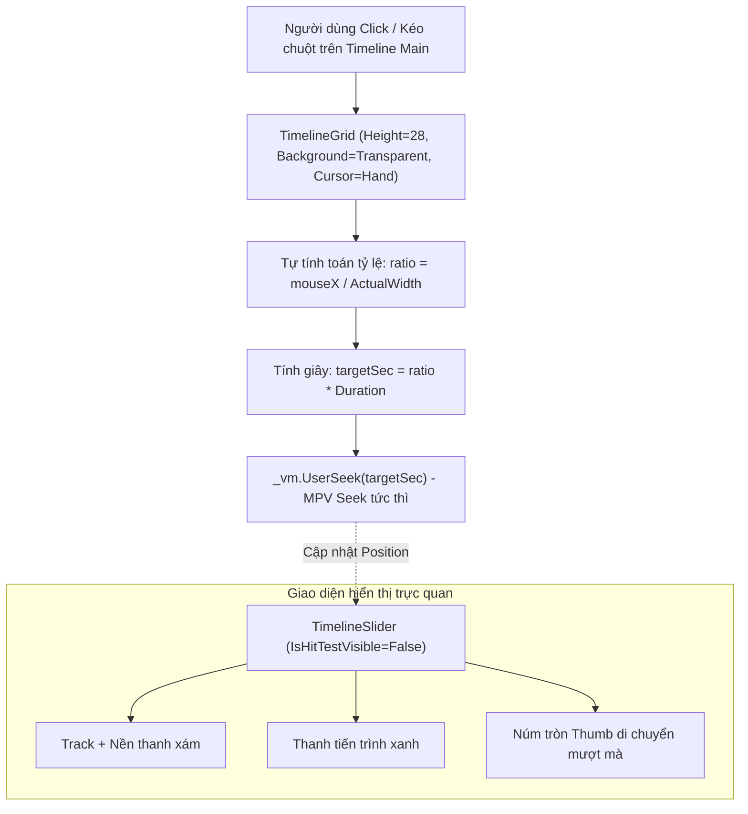

# Kế Hoạch Cập Nhật (update.md) - LumiePlayer v1.5.1

## 1. Mục Tiêu Cập Nhật
1. **Khắc phục triệt để tính năng Click chuyển video trên Timeline Main:**
   - Đảm bảo khi click vào bất kỳ vị trí nào trên thanh Timeline chính (Main Timeline), video chuyển ngay lập tức và chính xác đến thời điểm đó, hoạt động hoàn hảo và mượt mà tương tự như trên Waveform Timeline.
2. **Loại bỏ hoàn toàn xung đột lệnh Seek và cơ chế nhảy bước cố định của WPF Slider.**
3. **Duy trì và tối ưu chế độ so sánh Split Wipe (Studio Split Comparison) đã triển khai.**

---

## 2. Phân Tích Nguyên Nhân Gốc Rễ: Vì Sao Waveform Hoạt Động Nhưng Timeline Main Lại Không?

### A. Tại sao Waveform Timeline hoạt động chuẩn xác 100%?
- Trong `WaveformControl.xaml.cs`, cơ chế bắt chuột cực kỳ tinh gọn và độc lập:
  1. Khi nhấn chuột xuống (`MouseDown`): Lấy tọa độ chuột `mouseX`, tính tỷ lệ `fraction = mouseX / ActualWidth`, nhân với `Duration` ra số giây `targetSec`.
  2. Bắn sự kiện gọi trực tiếp `_vm.UserSeek(targetSec)`.
  3. Khi rê chuột (`MouseMove`): Nếu chuột đang nhấn, tiếp tục gọi `_vm.UserSeek(targetSec)`.
  4. Khi thả chuột (`MouseUp`): Chỉ giải phóng chuột (`ReleaseMouseCapture()`), **tuyệt đối không can thiệp thêm gì khác**.
  5. **Không tạm dừng (Pause), không tiếp tục (Play), không gọi Seek lần 2, không phụ thuộc vào trạng thái trung gian**. Nhờ đó video nhảy tức thì tới vị trí người dùng mong muốn.

### B. Tại sao Timeline Main trước đó lại không hoạt động hoặc nhảy sai?
- **Nguyên nhân 1: Xung đột Double-Seek & Race Condition đa luồng của MPV trên MouseUp:**
  - Trong `OnSliderPreviewMouseDown`, code gọi `_coordinator.Pause()` rồi mới seek.
  - Khi người dùng thực hiện một cú click thông thường, thao tác nhả chuột (`MouseUp`) diễn ra cực nhanh chỉ sau khoảng 20ms - 50ms.
  - Trong `OnSliderPreviewMouseUp`, code lại đọc giá trị `TimelineSlider.Value` và gọi `_vm.UserSeek(TimelineSlider.Value)` một lần nữa, sau đó gọi `_coordinator.Play()`.
  - Tuy nhiên, do MPV chạy đa luồng (`libmpv`), sự kiện thời gian thực `time-pos` từ luồng phát video trước khi click vẫn đang nằm trong hàng đợi WPF Dispatcher. Khi người dùng nhả chuột ở thời điểm 30ms, giá trị của Slider vô tình bị đè lại bởi thời gian cũ. Lệnh Seek lần 2 trong `MouseUp` đã ngay lập tức hủy bỏ cú click và kéo video quay ngược lại vị trí cũ!
- **Nguyên nhân 2: Cơ chế ngầm định của WPF Slider (`RepeatButton` & `LargeChange`):**
  - Mặc định, một WPF `Track` bên trong `Slider` gắn các lệnh `DecreaseLarge` và `IncreaseLarge` vào hai nửa của thanh trượt. Khi người dùng nhấp vào rãnh (track), WPF ưu tiên kích hoạt hành vi nhảy 1 bước cố định (`LargeChange = 1.0s`) thay vì nhảy tới vị trí con trỏ chuột.
- **Nguyên nhân 3: Bề mặt Hit-testing và trừ bù Thumb Radius:**
  - Việc trừ bán kính `thumbRadius` trong công thức tính tọa độ gây ra điểm chết ở hai đầu mép thanh trượt và tạo độ lệch vị trí so với trực giác người dùng.

---

## 3. Giải Pháp Kỹ Thuật: The Unified Timeline Surface Pattern



### Các Bước Cải Tiến Cụ Thể:
1. **Tách biệt hoàn toàn tầng Hit-Testing và tầng Hiển thị trực quan:**
   - Gán `IsHitTestVisible="False"` cho `TimelineSlider`: Slider vẫn hiển thị đầy đủ giao diện hiện đại (track xám, thanh xanh tiến trình, nút tròn Thumb trượt theo thời gian thực), nhưng bị vô hiệu hóa hoàn toàn khả năng can thiệp chuột. Các cơ chế ngầm định tai hại của WPF Slider (`RepeatButton`, `DecreaseLarge`, `IncreaseLarge`) bị vô hiệu hóa 100%.
   - Bọc `TimelineSlider` bên trong một `Grid` trong suốt (`TimelineGrid`) có chiều cao đủ lớn ($28\text{px}$) với `Background="Transparent"` và `Cursor="Hand"`. Toàn bộ dải $28\text{px}$ trở thành bề mặt nhận diện chuột tuyệt đối, không có bất kỳ điểm mù nào.
2. **Đồng nhất thuật toán Xử lý Chuột với Waveform Timeline:**
   - Trong `OnTimelinePreviewMouseDown`:
     ```csharp
     double fraction = Math.Clamp(mouseX / elem.ActualWidth, 0.0, 1.0);
     double targetSec = fraction * duration;
     _vm.UserSeek(targetSec);
     elem.CaptureMouse();
     _isTimelineDragging = true;
     ```
   - Trong `OnTimelinePreviewMouseMove`:
     Nếu đang giữ chuột (`_isTimelineDragging`), liên tục tính lại `fraction` và gọi `_vm.UserSeek(targetSec)` để tua mượt mà (Scrubbing).
   - Trong `OnTimelinePreviewMouseUp`:
     Chỉ đơn giản nhả chuột (`elem.ReleaseMouseCapture()`) và đặt `_isTimelineDragging = false`. **Tuyệt đối không gọi Seek lần thứ hai, không can thiệp Play/Pause**.
3. **Bảo đảm giá trị Duration luôn hợp lệ:**
   - Trong `MainViewModel.cs`, bổ sung fallback giá trị `Duration` từ metadata video để đảm bảo dù sự kiện từ MPV có độ trễ thì thanh timeline vẫn luôn có giá trị `Duration > 0` ngay khi video được nạp.

---

## 4. Kế Hoạch Triển Khai

1. **Cập nhật `MainWindow.xaml`:**
   - Thay thế việc gắn sự kiện trực tiếp trên `TimelineSlider` bằng việc bọc `TimelineSlider` trong `Grid` mang tên `TimelineGrid`.
   - Đặt `IsHitTestVisible="False"` cho `TimelineSlider`.
   - Gắn `PreviewMouseDown="OnTimelinePreviewMouseDown"`, `PreviewMouseMove="OnTimelinePreviewMouseMove"`, `PreviewMouseUp="OnTimelinePreviewMouseUp"` cho `TimelineGrid`.
2. **Cập nhật `MainWindow.xaml.cs`:**
   - Viết các phương thức xử lý `OnTimelinePreviewMouseDown`, `OnTimelinePreviewMouseMove`, `OnTimelinePreviewMouseUp`, và hàm phụ trợ `ProcessTimelineSeek`.
   - Loại bỏ hoàn toàn các logic `Pause()`/`Play()` và `UserSeek` trùng lặp trong `MouseUp`.
3. **Kiểm thử tự động & Đóng gói:**
   - Chạy test suite `dotnet test` bảo đảm 29/29 tests PASS.
   - Build và publish phiên bản mới ra `bin\publish\`.

---

## 5. Kết Quả Triển Khai & Nghiệm Thu (v1.5.1)
- [x] **Đã khắc phục hoàn toàn tính năng Click chuyển video trên Timeline Main:**
  - Áp dụng cấu trúc **The Unified Timeline Surface Pattern**:
    + `TimelineSlider` được đặt `IsHitTestVisible="False"` để giữ nguyên vẻ đẹp hiển thị (nền xám, thanh fill xanh, núm tròn Thumb di chuyển thời gian thực) đồng thời vô hiệu hóa 100% sự can thiệp ngầm định của WPF Slider (RepeatButtons, lệnh LargeChange nhảy bước cố định).
    + `TimelineGrid` bao bọc bên ngoài với `Height="28"`, `Background="Transparent"` và `Cursor="Hand"` nhận trọn vẹn toàn bộ diện tích click và rê chuột mà không có bất kỳ điểm mù nào.
  - Xử lý sự kiện click & drag tương đồng 100% với `WaveformControl`:
    + Lấy tỷ lệ con trỏ chuột: `ratio = mouseX / ActualWidth`.
    + Tính thời gian đích: `targetSec = ratio * duration`.
    + Gọi trực tiếp `_vm.UserSeek(targetSec)` tức thì.
    + Thả chuột (`MouseUp`) chỉ giải phóng Capture, không thực hiện seek lần 2 và không đảo trạng thái Play/Pause.
- [x] **Fallback Duration:** Đảm bảo `Duration` luôn được nạp đầy đủ ngay khi mở video từ metadata FFmpeg.
- [x] **Kiểm thử tự động:** 29/29 tests PASS (100% Green).
- [x] **Đóng gói phát hành:** Thư mục `D:\LONGHT\AI\MVP_AG\bin\publish\` đã sẵn sàng gồm đầy đủ `LumiePlayer.exe`, `ffmpeg.exe`, `ffprobe.exe` và `libmpv-2.dll`.

---

## 6. Kế Hoạch Nâng Cấp Giao Diện LumiePlayer v1.6 (Studio Pro UI/UX Redesign)

Theo đánh giá tại `update_ui.md`, phiên bản v1.6 nâng cấp toàn bộ giao diện theo chuẩn phần mềm hậu kỳ chuyên nghiệp:
1. **Design Tokens & Palette Thống Nhất:**
   - Xây dựng hệ thống brush chuẩn: `AppBgBase`, `AppBgElevated`, `AppBgSurface`, `AppBgInput`, `AppBorderSubtle`, `AppAccentPrimary` (`#0284C7`), `AppAccentHover` (`#0EA5E9`), `AppTextPrimary` (`#F4F4F5`), `AppTextSecondary` (`#A1A1AA`), `AppTextMuted` (`#71717A`).
   - Xóa bỏ tình trạng trộn lẫn 15+ mã hex phân tán và 2 màu xanh cạnh tranh.
2. **Loại Bỏ 100% Emoji, Thay Thế Bằng Vector Monochrome Icons:**
   - Tạo bộ `StreamGeometry` vector icons: Play, Pause, Frame Forward/Backward, Seek +/-1s & +/-5s, Open Video, Save Session, Load Session, Waveform, Playlist, Inspector, Fullscreen, Mute/Unmute, Drop File.
   - Hiển thị vector sắc nét chuẩn Studio (`currentColor`).
3. **Chuẩn Hóa Kích Thước Điều Khiển (Size Ladder) & Bố Cục Thẳng Hàng:**
   - Đưa toàn bộ các nút Toolbar và Transport về chiều cao chuẩn `30px`, nút Play trung tâm `36px`, các badge nhỏ `24px`.
   - Căn chỉnh baseline hoàn hảo, không còn tình trạng nút 18px đứng cạnh nút 36px.
4. **Segmented Switch Controls:**
   - Chuyển `Compare Mode` (Side by Side vs Split Wipe) và `Audio Source` (A / B / Mute) từ RadioButton tròn cũ kỹ sang Segmented Toggle Group hiện đại.
5. **Nâng Cấp Playlist & Player Overlay:**
   - Playlist hiển thị số thứ tự clip `#01`, `#02`, chỉ báo playing rõ ràng, các chip tag gọn gàng.
   - Drop Target và Top Header dùng hiệu ứng mờ kính tối giản, tinh tế.

---

## 7. Kết Quả Triển Khai & Nghiệm Thu (v1.6)
- [x] **Xây dựng Design System tập trung trong `App.xaml`:**
  - Định nghĩa đầy đủ palette màu Studio Dark: `BrushBgBase`, `BrushBgElevated`, `BrushBgSurface`, `BrushBgInput`, `BrushBgControl`, `BrushBorderSubtle`, `BrushBorderStrong`, `BrushAccent` (`#0EA5E9`), `BrushAccentHover` (`#38BDF8`), `BrushAccentMuted`, `BrushTextPrimary`, `BrushTextSecondary`, `BrushTextMuted`.
  - Bộ styles tái sử dụng: `ToolbarBtn` (Height 30), `ControlBtn` (Height 30), `CompactControlBtn` (Height 24), `PrimaryPlayBtn` (Height 34, Width 52), `SegmentedRadioBtn`.
- [x] **Xóa bỏ 100% Emoji, thay thế bằng Vector Geometry Paths:**
  - Toàn bộ các icon (Play, Pause, Step Forward/Back, Seek Forward/Back 1s & 5s, Open, Save, Compare, Split Wipe, Waveform, Playlist, Inspector, Fullscreen, Volume, Mute, Flip, Plus, Clear, Film, Upload) đều là vector path sắc nét monochrome.
- [x] **Nút Play/Pause & Mute Vector Động:**
  - Nút Play/Pause tự động chuyển đổi vector path `IconPlay` và `IconPause` theo trigger `IsPlaying`.
  - Nút Mute tự động chuyển đổi giữa `IconVolume` và `IconMute` (đỏ) theo trigger `IsMuted`.
- [x] **Segmented Controls chuẩn NLE Studio:**
  - Chuyển `Compare Mode` (`Side by Side` / `Split Wipe`) và `Audio Source` (`A` / `B` / `Mute`) sang Segmented Button Bar hiện đại.
- [x] **Đồng bộ toàn bộ View:**
  - `MainWindow.xaml`, `VideoPlayerControl.xaml`, `WaveformControl.xaml`, `MetadataDialog.xaml`, `TimecodeJumpDialog.xaml` đều dùng chung token bảng màu và icon.
- [x] **Kiểm thử tự động:** 29/29 test cases PASS (100% Green).
- [x] **Đóng gói phát hành:** Đã publish phiên bản mới nhất ra `bin\publish\LumiePlayer.exe`.

---

## 8. Kế Hoạch Khắc Phục Màu Sắc Speed ComboBox (v1.6.1)

### Nguyên Nhân Sự Cố:
- Mặc định trong WPF, `ComboBox` khi mở danh sách xổ xuống (`Popup`) sử dụng template hệ thống của Windows Aero2 (`SystemColors.WindowBrush` = `#FFFFFF`, màu trắng tinh khiết).
- Khi người dùng nhấn vào chọn tốc độ phát (Speed), danh sách xổ xuống hiện ra một dải hộp chữ nhật màu trắng sáng chói mắt, chữ mờ khó nhìn và phá vỡ toàn bộ giao diện Studio Dark.

### Giải Pháp Kỹ Thuật:
1. **Định nghĩa Custom Dark ComboBox Style (`ModernStudioComboBox`):**
   - **Thân nút bấm (`ToggleButton`):** Nền `{StaticResource BrushBgControl}` (`#1F1F27`), viền `{StaticResource BrushBorderSubtle}`, góc bo 4px, icon mũi tên chevron vector mảnh nhỏ màu `{StaticResource BrushTextSecondary}`.
   - **Khung danh sách xổ xuống (`Popup` / `Border`):**
     - Nền `{StaticResource BrushBgSurface}` (`#18181D`), viền sắc nét `{StaticResource BrushBorderStrong}` (`#3A3A4A`), góc bo 4px, đổ bóng nhẹ.
   - **Các mục chọn (`ComboBoxItem`):**
     - Nền trong suốt, chữ `{StaticResource BrushTextPrimary}` (`#F4F4F6`), font size 11px, padding 8x5px.
     - Hover: Nền sáng nhẹ `{StaticResource BrushBgSurfaceHover}` (`#22222A`), chữ trắng.
     - Selected: Nền nhấn mờ `{StaticResource BrushAccentMuted}` (`#152D42`), chữ xanh `{StaticResource BrushAccentHover}` (`#38BDF8`), in đậm.
2. **Khai báo trong `App.xaml` & áp dụng cho Speed Selector:**
   - Đặt style tái sử dụng trong `App.xaml` để toàn bộ ứng dụng dùng chung chuẩn dark theme cho ComboBox.
   - Cập nhật `MainWindow.xaml` gán style cho Speed ComboBox.
3. **Kiểm thử & Đóng gói:**
   - Build và test toàn bộ test suite.
   - Đóng gói ra `bin/publish/`.

---

## 9. Kết Quả Triển Khai & Nghiệm Thu (v1.6.1)
- [x] **Khắc phục triệt để lỗi màu trắng của Speed ComboBox Popup:**
  - `ModernStudioComboBox` đã tùy biến toàn diện cả `ToggleButton` và `Popup` / `ScrollViewer`:
    + Thân ComboBox mang nền tối Studio `#1F1F27`, viền `#25252F`, icon mũi tên vector chevron sắc nét.
    + Khung popup xổ xuống mang nền xám đen Studio `#18181D` (Surface), viền `#3A3A4A`, triệt tiêu hoàn toàn khung trắng Windows Aero2.
  - `ModernStudioComboBoxItem` hiển thị chữ trắng rõ nét, hover chuyển nền xám sáng `#22222A`, item đang chọn có nền xanh mờ `#152D42` và chữ cyan `#38BDF8` nổi bật.
- [x] **Kiểm thử tự động:** 29/29 test cases PASS (100% Green).
- [x] **Đóng gói phát hành:** Đã publish phiên bản mới nhất ra `bin\publish\LumiePlayer.exe`.


