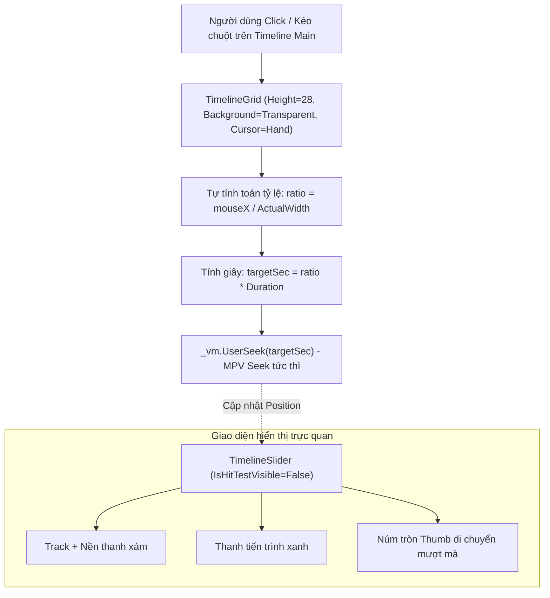

# Kế Hoạch Cập Nhật (update.md) - LumiePlayer v1.5.1

## 1. Mục Tiêu Cập Nhật
1. **Khắc phục triệt để tính năng Click chuyển video trên Timeline Main:**
   - Đảm bảo khi click vào bất kỳ vị trí nào trên thanh Timeline chính (Main Timeline), video chuyển ngay lập tức và chính xác đến thời điểm đó, hoạt động hoàn hảo và mượt mà tương tự như trên Waveform Timeline.
2. **Loại bỏ hoàn toàn xung đột lệnh Seek và cơ chế nhảy bước cố định của WPF Slider.**
3. **Duy trì và tối ưu chế độ so sánh Split Wipe (Studio Split Comparison) đã triển khai.**

---

## 2. Phân Tích Nguyên Nhân Gốc Rễ: Vì Sao Waveform Hoạt Động Nhưng Timeline Main Lại Không?

### A. Tại sao Waveform Timeline hoạt động chuẩn xác 100%?
- Trong `WaveformControl.xaml.cs`, cơ chế bắt chuột cực kỳ tinh gọn và độc lập:
  1. Khi nhấn chuột xuống (`MouseDown`): Lấy tọa độ chuột `mouseX`, tính tỷ lệ `fraction = mouseX / ActualWidth`, nhân với `Duration` ra số giây `targetSec`.
  2. Bắn sự kiện gọi trực tiếp `_vm.UserSeek(targetSec)`.
  3. Khi rê chuột (`MouseMove`): Nếu chuột đang nhấn, tiếp tục gọi `_vm.UserSeek(targetSec)`.
  4. Khi thả chuột (`MouseUp`): Chỉ giải phóng chuột (`ReleaseMouseCapture()`), **tuyệt đối không can thiệp thêm gì khác**.
  5. **Không tạm dừng (Pause), không tiếp tục (Play), không gọi Seek lần 2, không phụ thuộc vào trạng thái trung gian**. Nhờ đó video nhảy tức thì tới vị trí người dùng mong muốn.

### B. Tại sao Timeline Main trước đó lại không hoạt động hoặc nhảy sai?
- **Nguyên nhân 1: Xung đột Double-Seek & Race Condition đa luồng của MPV trên MouseUp:**
  - Trong `OnSliderPreviewMouseDown`, code gọi `_coordinator.Pause()` rồi mới seek.
  - Khi người dùng thực hiện một cú click thông thường, thao tác nhả chuột (`MouseUp`) diễn ra cực nhanh chỉ sau khoảng 20ms - 50ms.
  - Trong `OnSliderPreviewMouseUp`, code lại đọc giá trị `TimelineSlider.Value` và gọi `_vm.UserSeek(TimelineSlider.Value)` một lần nữa, sau đó gọi `_coordinator.Play()`.
  - Tuy nhiên, do MPV chạy đa luồng (`libmpv`), sự kiện thời gian thực `time-pos` từ luồng phát video trước khi click vẫn đang nằm trong hàng đợi WPF Dispatcher. Khi người dùng nhả chuột ở thời điểm 30ms, giá trị của Slider vô tình bị đè lại bởi thời gian cũ. Lệnh Seek lần 2 trong `MouseUp` đã ngay lập tức hủy bỏ cú click và kéo video quay ngược lại vị trí cũ!
- **Nguyên nhân 2: Cơ chế ngầm định của WPF Slider (`RepeatButton` & `LargeChange`):**
  - Mặc định, một WPF `Track` bên trong `Slider` gắn các lệnh `DecreaseLarge` và `IncreaseLarge` vào hai nửa của thanh trượt. Khi người dùng nhấp vào rãnh (track), WPF ưu tiên kích hoạt hành vi nhảy 1 bước cố định (`LargeChange = 1.0s`) thay vì nhảy tới vị trí con trỏ chuột.
- **Nguyên nhân 3: Bề mặt Hit-testing và trừ bù Thumb Radius:**
  - Việc trừ bán kính `thumbRadius` trong công thức tính tọa độ gây ra điểm chết ở hai đầu mép thanh trượt và tạo độ lệch vị trí so với trực giác người dùng.

---

## 3. Giải Pháp Kỹ Thuật: The Unified Timeline Surface Pattern



### Các Bước Cải Tiến Cụ Thể:
1. **Tách biệt hoàn toàn tầng Hit-Testing và tầng Hiển thị trực quan:**
   - Gán `IsHitTestVisible="False"` cho `TimelineSlider`: Slider vẫn hiển thị đầy đủ giao diện hiện đại (track xám, thanh xanh tiến trình, nút tròn Thumb trượt theo thời gian thực), nhưng bị vô hiệu hóa hoàn toàn khả năng can thiệp chuột. Các cơ chế ngầm định tai hại của WPF Slider (`RepeatButton`, `DecreaseLarge`, `IncreaseLarge`) bị vô hiệu hóa 100%.
   - Bọc `TimelineSlider` bên trong một `Grid` trong suốt (`TimelineGrid`) có chiều cao đủ lớn ($28\text{px}$) với `Background="Transparent"` và `Cursor="Hand"`. Toàn bộ dải $28\text{px}$ trở thành bề mặt nhận diện chuột tuyệt đối, không có bất kỳ điểm mù nào.
2. **Đồng nhất thuật toán Xử lý Chuột với Waveform Timeline:**
   - Trong `OnTimelinePreviewMouseDown`:
     ```csharp
     double fraction = Math.Clamp(mouseX / elem.ActualWidth, 0.0, 1.0);
     double targetSec = fraction * duration;
     _vm.UserSeek(targetSec);
     elem.CaptureMouse();
     _isTimelineDragging = true;
     ```
   - Trong `OnTimelinePreviewMouseMove`:
     Nếu đang giữ chuột (`_isTimelineDragging`), liên tục tính lại `fraction` và gọi `_vm.UserSeek(targetSec)` để tua mượt mà (Scrubbing).
   - Trong `OnTimelinePreviewMouseUp`:
     Chỉ đơn giản nhả chuột (`elem.ReleaseMouseCapture()`) và đặt `_isTimelineDragging = false`. **Tuyệt đối không gọi Seek lần thứ hai, không can thiệp Play/Pause**.
3. **Bảo đảm giá trị Duration luôn hợp lệ:**
   - Trong `MainViewModel.cs`, bổ sung fallback giá trị `Duration` từ metadata video để đảm bảo dù sự kiện từ MPV có độ trễ thì thanh timeline vẫn luôn có giá trị `Duration > 0` ngay khi video được nạp.

---

## 4. Kế Hoạch Triển Khai

1. **Cập nhật `MainWindow.xaml`:**
   - Thay thế việc gắn sự kiện trực tiếp trên `TimelineSlider` bằng việc bọc `TimelineSlider` trong `Grid` mang tên `TimelineGrid`.
   - Đặt `IsHitTestVisible="False"` cho `TimelineSlider`.
   - Gắn `PreviewMouseDown="OnTimelinePreviewMouseDown"`, `PreviewMouseMove="OnTimelinePreviewMouseMove"`, `PreviewMouseUp="OnTimelinePreviewMouseUp"` cho `TimelineGrid`.
2. **Cập nhật `MainWindow.xaml.cs`:**
   - Viết các phương thức xử lý `OnTimelinePreviewMouseDown`, `OnTimelinePreviewMouseMove`, `OnTimelinePreviewMouseUp`, và hàm phụ trợ `ProcessTimelineSeek`.
   - Loại bỏ hoàn toàn các logic `Pause()`/`Play()` và `UserSeek` trùng lặp trong `MouseUp`.
3. **Kiểm thử tự động & Đóng gói:**
   - Chạy test suite `dotnet test` bảo đảm 29/29 tests PASS.
   - Build và publish phiên bản mới ra `bin\publish\`.

---

## 5. Kết Quả Triển Khai & Nghiệm Thu (v1.5.1)
- [x] **Đã khắc phục hoàn toàn tính năng Click chuyển video trên Timeline Main:**
  - Áp dụng cấu trúc **The Unified Timeline Surface Pattern**:
    + `TimelineSlider` được đặt `IsHitTestVisible="False"` để giữ nguyên vẻ đẹp hiển thị (nền xám, thanh fill xanh, núm tròn Thumb di chuyển thời gian thực) đồng thời vô hiệu hóa 100% sự can thiệp ngầm định của WPF Slider (RepeatButtons, lệnh LargeChange nhảy bước cố định).
    + `TimelineGrid` bao bọc bên ngoài với `Height="28"`, `Background="Transparent"` và `Cursor="Hand"` nhận trọn vẹn toàn bộ diện tích click và rê chuột mà không có bất kỳ điểm mù nào.
  - Xử lý sự kiện click & drag tương đồng 100% với `WaveformControl`:
    + Lấy tỷ lệ con trỏ chuột: `ratio = mouseX / ActualWidth`.
    + Tính thời gian đích: `targetSec = ratio * duration`.
    + Gọi trực tiếp `_vm.UserSeek(targetSec)` tức thì.
    + Thả chuột (`MouseUp`) chỉ giải phóng Capture, không thực hiện seek lần 2 và không đảo trạng thái Play/Pause.
- [x] **Fallback Duration:** Đảm bảo `Duration` luôn được nạp đầy đủ ngay khi mở video từ metadata FFmpeg.
- [x] **Kiểm thử tự động:** 29/29 tests PASS (100% Green).
- [x] **Đóng gói phát hành:** Thư mục `D:\LONGHT\AI\MVP_AG\bin\publish\` đã sẵn sàng gồm đầy đủ `LumiePlayer.exe`, `ffmpeg.exe`, `ffprobe.exe` và `libmpv-2.dll`.

---

## 6. Kế Hoạch Nâng Cấp Giao Diện LumiePlayer v1.6 (Studio Pro UI/UX Redesign)

Theo đánh giá tại `update_ui.md`, phiên bản v1.6 nâng cấp toàn bộ giao diện theo chuẩn phần mềm hậu kỳ chuyên nghiệp:
1. **Design Tokens & Palette Thống Nhất:**
   - Xây dựng hệ thống brush chuẩn: `AppBgBase`, `AppBgElevated`, `AppBgSurface`, `AppBgInput`, `AppBorderSubtle`, `AppAccentPrimary` (`#0284C7`), `AppAccentHover` (`#0EA5E9`), `AppTextPrimary` (`#F4F4F5`), `AppTextSecondary` (`#A1A1AA`), `AppTextMuted` (`#71717A`).
   - Xóa bỏ tình trạng trộn lẫn 15+ mã hex phân tán và 2 màu xanh cạnh tranh.
2. **Loại Bỏ 100% Emoji, Thay Thế Bằng Vector Monochrome Icons:**
   - Tạo bộ `StreamGeometry` vector icons: Play, Pause, Frame Forward/Backward, Seek +/-1s & +/-5s, Open Video, Save Session, Load Session, Waveform, Playlist, Inspector, Fullscreen, Mute/Unmute, Drop File.
   - Hiển thị vector sắc nét chuẩn Studio (`currentColor`).
3. **Chuẩn Hóa Kích Thước Điều Khiển (Size Ladder) & Bố Cục Thẳng Hàng:**
   - Đưa toàn bộ các nút Toolbar và Transport về chiều cao chuẩn `30px`, nút Play trung tâm `36px`, các badge nhỏ `24px`.
   - Căn chỉnh baseline hoàn hảo, không còn tình trạng nút 18px đứng cạnh nút 36px.
4. **Segmented Switch Controls:**
   - Chuyển `Compare Mode` (Side by Side vs Split Wipe) và `Audio Source` (A / B / Mute) từ RadioButton tròn cũ kỹ sang Segmented Toggle Group hiện đại.
5. **Nâng Cấp Playlist & Player Overlay:**
   - Playlist hiển thị số thứ tự clip `#01`, `#02`, chỉ báo playing rõ ràng, các chip tag gọn gàng.
   - Drop Target và Top Header dùng hiệu ứng mờ kính tối giản, tinh tế.

---

## 7. Kết Quả Triển Khai & Nghiệm Thu (v1.6)
- [x] **Xây dựng Design System tập trung trong `App.xaml`:**
  - Định nghĩa đầy đủ palette màu Studio Dark: `BrushBgBase`, `BrushBgElevated`, `BrushBgSurface`, `BrushBgInput`, `BrushBgControl`, `BrushBorderSubtle`, `BrushBorderStrong`, `BrushAccent` (`#0EA5E9`), `BrushAccentHover` (`#38BDF8`), `BrushAccentMuted`, `BrushTextPrimary`, `BrushTextSecondary`, `BrushTextMuted`.
  - Bộ styles tái sử dụng: `ToolbarBtn` (Height 30), `ControlBtn` (Height 30), `CompactControlBtn` (Height 24), `PrimaryPlayBtn` (Height 34, Width 52), `SegmentedRadioBtn`.
- [x] **Xóa bỏ 100% Emoji, thay thế bằng Vector Geometry Paths:**
  - Toàn bộ các icon (Play, Pause, Step Forward/Back, Seek Forward/Back 1s & 5s, Open, Save, Compare, Split Wipe, Waveform, Playlist, Inspector, Fullscreen, Volume, Mute, Flip, Plus, Clear, Film, Upload) đều là vector path sắc nét monochrome.
- [x] **Nút Play/Pause & Mute Vector Động:**
  - Nút Play/Pause tự động chuyển đổi vector path `IconPlay` và `IconPause` theo trigger `IsPlaying`.
  - Nút Mute tự động chuyển đổi giữa `IconVolume` và `IconMute` (đỏ) theo trigger `IsMuted`.
- [x] **Segmented Controls chuẩn NLE Studio:**
  - Chuyển `Compare Mode` (`Side by Side` / `Split Wipe`) và `Audio Source` (`A` / `B` / `Mute`) sang Segmented Button Bar hiện đại.
- [x] **Đồng bộ toàn bộ View:**
  - `MainWindow.xaml`, `VideoPlayerControl.xaml`, `WaveformControl.xaml`, `MetadataDialog.xaml`, `TimecodeJumpDialog.xaml` đều dùng chung token bảng màu và icon.
- [x] **Kiểm thử tự động:** 29/29 test cases PASS (100% Green).
- [x] **Đóng gói phát hành:** Đã publish phiên bản mới nhất ra `bin\publish\LumiePlayer.exe`.


---

## 8. Kế Hoạch Khắc Phục Màu Sắc Speed ComboBox (v1.6.1)

### Nguyên Nhân Sự Cố:
- Mặc định trong WPF, `ComboBox` khi mở danh sách xổ xuống (`Popup`) sử dụng template hệ thống của Windows Aero2 (`SystemColors.WindowBrush` = `#FFFFFF`, màu trắng tinh khiết).
- Khi người dùng nhấn vào chọn tốc độ phát (Speed), danh sách xổ xuống hiện ra một dải hộp chữ nhật màu trắng sáng chói mắt, chữ mờ khó nhìn và phá vỡ toàn bộ giao diện Studio Dark.

### Giải Pháp Kỹ Thuật:
1. **Định nghĩa Custom Dark ComboBox Style (`ModernStudioComboBox`):**
   - **Thân nút bấm (`ToggleButton`):** Nền `{StaticResource BrushBgControl}` (`#1F1F27`), viền `{StaticResource BrushBorderSubtle}`, góc bo 4px, icon mũi tên chevron vector mảnh nhỏ màu `{StaticResource BrushTextSecondary}`.
   - **Khung danh sách xổ xuống (`Popup` / `Border`):**
     - Nền `{StaticResource BrushBgSurface}` (`#18181D`), viền sắc nét `{StaticResource BrushBorderStrong}` (`#3A3A4A`), góc bo 4px, đổ bóng nhẹ.
   - **Các mục chọn (`ComboBoxItem`):**
     - Nền trong suốt, chữ `{StaticResource BrushTextPrimary}` (`#F4F4F6`), font size 11px, padding 8x5px.
     - Hover: Nền sáng nhẹ `{StaticResource BrushBgSurfaceHover}` (`#22222A`), chữ trắng.
     - Selected: Nền nhấn mờ `{StaticResource BrushAccentMuted}` (`#152D42`), chữ xanh `{StaticResource BrushAccentHover}` (`#38BDF8`), in đậm.
2. **Khai báo trong `App.xaml` & áp dụng cho Speed Selector:**
   - Đặt style tái sử dụng trong `App.xaml` để toàn bộ ứng dụng dùng chung chuẩn dark theme cho ComboBox.
   - Cập nhật `MainWindow.xaml` gán style cho Speed ComboBox.
3. **Kiểm thử & Đóng gói:**
   - Build và test toàn bộ test suite.
   - Đóng gói ra `bin/publish/`.

---

## 9. Kết Quả Triển Khai & Nghiệm Thu (v1.6.1)
- [x] **Khắc phục triệt để lỗi màu trắng của Speed ComboBox Popup:**
  - `ModernStudioComboBox` đã tùy biến toàn diện cả `ToggleButton` và `Popup` / `ScrollViewer`:
    + Thân ComboBox mang nền tối Studio `#1F1F27`, viền `#25252F`, icon mũi tên vector chevron sắc nét.
    + Khung popup xổ xuống mang nền xám đen Studio `#18181D` (Surface), viền `#3A3A4A`, triệt tiêu hoàn toàn khung trắng Windows Aero2.
  - `ModernStudioComboBoxItem` hiển thị chữ trắng rõ nét, hover chuyển nền xám sáng `#22222A`, item đang chọn có nền xanh mờ `#152D42` và chữ cyan `#38BDF8` nổi bật.
- [x] **Kiểm thử tự động:** 29/29 test cases PASS (100% Green).
- [x] **Đóng gói phát hành:** Đã publish phiên bản mới nhất ra `bin\publish\LumiePlayer.exe`.


---

## 10. Kế Hoạch Cập Nhật Tính Năng Phát Lại, Chế Độ Lặp (Loop/PingPong), Cải Tiến Timeline & Tùy Biến Phím Tắt (v1.7)

### 1. Mục Tiêu Cập Nhật
Theo yêu cầu mới của người dùng và thiết kế từ ảnh chụp đính kèm:
1. **Phát lại từ đầu khi video kết thúc (Space to Replay):** Nhấn phím `Space` khi video đã kết thúc sẽ tự động tua về đầu và tiếp tục phát (thay vì bị kẹt lại ở frame cuối cùng).
2. **Hệ thống chế độ lặp 3 trạng thái:** Bổ sung tùy chọn `No Loop` (Phát 1 lần rồi dừng) / `Loop` (Lặp vô tận) / `Ping Pong` (Đảo chiều phát xuôi - ngược liên tục).
3. **Hiển thị trực quan đoạn Loop A-B trên Timeline:** Thêm dải màu highlight amber `#F59E0B` và 2 cọc mốc giới hạn In-point `[` và Out-point `]` nổi bật trên thanh timeline chính và waveform.
4. **Menu chuột phải (Context Menu) chọn định dạng hiển thị:** Cho phép nhấp chuột phải vào Timeline để chọn hiển thị theo `Timecode (hh:mm:ss.fff)` hoặc `Số Frame (#1234)`.
5. **Nhãn thời gian nổi bám theo đầu đọc Playhead (Floating Timecode/Frame Pill):** Thiết kế nhãn chỉ số thời gian/frame nổi ngay phía trên thanh trượt, tự động di chuyển bám sát con trỏ playhead trong thời gian thực (chuẩn Studio NLE như ảnh tham khảo).
6. **Chỉnh sửa phím tắt Set Loop A/B mặc định thành `,` và `.` (hỗ trợ cả `/`):**
   - Đổi phím tắt từ `[` và `]` sang:
     - Set Loop A: Phím `,` (`OemComma` - dấu phẩy)
     - Set Loop B: Phím `.` (`OemPeriod` - dấu chấm, hỗ trợ linh hoạt cả phím `/` `OemQuestion`)
   - Cập nhật ToolTip nút A, B trên giao diện và văn bản hướng dẫn Shortcuts dưới thanh trạng thái.
7. **Bổ sung tính năng Custom Hotkey (Tùy biến phím tắt toàn diện):**
   - Cho phép người dùng tùy ý cấu hình lại bất kỳ phím tắt nào trong ứng dụng theo thói quen cá nhân.
   - Hộp thoại Cài đặt Phím tắt chuyên nghiệp (`HotkeySettingsDialog`) có khả năng bắt phím trực tiếp khi nhấn (Key Recording).
   - Lưu trữ tự động vào `settings.json` và hỗ trợ Khôi phục mặc định (Reset to Defaults).

---

### 2. Thiết Kế Kỹ Thuật Chi Tiết

#### A. Tự động Replay khi nhấn Space ở cuối video
- **Logic:** Trong `PlaybackCoordinator.TogglePlayPause()` và `MainViewModel.PlayPauseCommand`:
  - Kiểm tra nếu `_playerA.IsEnded` hoặc `_playerA.TimePos >= _playerA.Duration - 0.08`:
    - Gọi `Seek(LoopStart ?? 0, exact: true)`.
    - Gọi `Play()`.
  - Giúp thao tác xem đi xem lại video bằng phím Space mượt mà, không bị kẹt ở khung hình cuối.

#### B. Chế độ lặp Loop / Ping Pong / No Loop
- **Mô hình hóa:**
  ```csharp
  public enum PlaybackLoopMode
  {
      NoLoop,   // Dừng lại khi tới cuối (hoặc tới LoopEnd)
      Loop,     // Khi chạm cuối/LoopEnd, nhảy về đầu/LoopStart và tiếp tục phát xuôi
      PingPong  // Khi chạm cuối/LoopEnd, đảo chiều phát lùi (-); khi chạm đầu/LoopStart, đảo chiều phát xuôi (+)
  }
  ```
- **Xử lý Engine MPV:**
  - `MpvPlayer`: Tích hợp hàm `SetPlayDirection(bool forward)` điều khiển property `play-dir` (`+` hoặc `-`) của libmpv.
  - `PlaybackCoordinator`: Trong `OnPlayerATimePosChanged`, khi `TimePos` chạm giới hạn `LoopEnd` (hoặc EOF):
    - Nếu `Loop`: `Seek(LoopStart ?? 0)` và tiếp tục phát xuôi.
    - If `PingPong`: Nếu đang đi xuôi, chuyển hướng `play-dir = "-"` và phát lùi; khi lùi chạm `LoopStart ?? 0`, chuyển `play-dir = "+"` và phát xuôi.
    - If `NoLoop`: Gọi `Pause()`.
- **Giao diện điều khiển:**
  - Nút xoay vòng chế độ lặp trên Transport Bar với 3 trạng thái:
    - `[ ➔ Once ]` (No Loop)
    - `[ ↻ Loop ]` (Loop)
    - `[ ⇄ PingPong ]` (Ping Pong)
  - Phím tắt nhanh: `Ctrl+L` để chuyển đổi nhanh giữa 3 chế độ.

#### C. Thể hiện trực quan đoạn Loop A-B trên Timeline
- **Trên thanh Timeline chính (`TimelineGrid`):**
  - Bổ sung `Canvas` chứa `Border` dải lặp `TimelineLoopBand`:
    - Tọa độ `Left = (LoopStart / Duration) * Width`, `Width = ((LoopEnd - LoopStart) / Duration) * Width`.
    - Màu nền: `#33F59E0B` (Amber 20% opacity) với viền subtle `#F59E0B`.
  - Hai cọc mốc giới hạn:
    - Cọc In-Point `[A]`: Đường kẻ đứng màu vàng hổ phách `#F59E0B` (độ dày 2px) kèm icon cờ mốc `[`.
    - Cọc Out-Point `[B]`: Đường kẻ đứng màu vàng hổ phách `#F59E0B` kèm icon cờ mốc `]`.
- **Trên Waveform:** Bổ sung viền trái và viền phải màu hổ phách 2px cho `LoopRect`.

#### D. Chuột phải chọn định dạng hiển thị Timecode / Frame
- **Khai báo Context Menu:**
  - Nhấp chuột phải vào `TimelineGrid` hoặc khu vực Timecode để mở ContextMenu:
    - `Timecode (00:00:00.000)`
    - `Frame Numbers (#1234)`
- **Lưu cấu hình:** Lưu giá trị vào `AppSettings.TimeDisplayFormat` (`"Timecode"` / `"Frames"`).

#### E. Nhãn thời gian nổi bám theo đầu đọc Playhead (Theo ảnh tham khảo)
- **Cấu trúc giao diện Timeline 3 tầng:**
  - **Tầng 1 (Floating Playhead Label):**
    - `Canvas` nằm ngay phía trên thanh trượt.
    - Một thẻ nhãn `FloatingHeadPill` hiển thị số Frame (ví dụ `1` hoặc `1048`) hoặc Timecode (ví dụ `00:00:34.951`) tùy theo định dạng đang chọn.
    - Tọa độ `X` của thẻ nhãn được căn chỉnh chính xác theo đầu nút Thumb của Slider (`X = (Position / Duration) * ActualWidth`).
  - **Tầng 2 (Scrubbing Track & Loop Band):**
    - Thanh trượt, vạch xanh tiến trình, dải màu Loop A-B và nút tròn Thumb.
  - **Tầng 3 (Timeline Meta Info Row):**
    - Góc trái: Tổng số khung hình (ví dụ `3760 frames` hoặc thời lượng tổng).
    - Góc phải: Tần số quét khung hình (ví dụ `29.97 fps` / `60.00 fps`).

#### F. Chỉnh sửa phím tắt Set Loop A/B mặc định thành `,` và `.`
- Thay đổi ánh xạ phím tắt mặc định:
  - Phím `OemComma` (`,`) -> Gọi `SetLoopACommand` (đặt điểm bắt đầu In).
  - Phím `OemPeriod` (`.`) hoặc `OemQuestion` (`/`) -> Gọi `SetLoopBCommand` (đặt điểm kết thúc Out).
- Cập nhật ToolTip nút `Loop A`: `Set Loop Start (A) [key: ,]`.
- Cập nhật ToolTip nút `Loop B`: `Set Loop End (B) [key: .]`.
- Cập nhật văn bản chỉ dẫn Shortcuts ở thanh Footer để người dùng dễ theo dõi.

#### G. Kiến trúc Custom Hotkey System
- **Mô hình Dữ liệu (`HotkeyBinding.cs` & `HotkeyConfig.cs`):**
  ```csharp
  public class HotkeyBinding
  {
      public string ActionId { get; set; } = string.Empty;
      public string DisplayName { get; set; } = string.Empty;
      public string Category { get; set; } = "Playback"; // Playback, Navigation, Loop, View, File
      public Key Key { get; set; }
      public ModifierKeys Modifiers { get; set; } = ModifierKeys.None;
      public string KeyDisplay => FormatKey(Key, Modifiers);
  }
  ```
- **Danh mục Tác vụ hỗ trợ tùy biến phím tắt:**
  - *Playback:* Play/Pause (`Space`), Step Forward (`Right`), Step Backward (`Left`), Seek ±1s (`Shift+Right`/`Shift+Left`), Seek ±5s, Toggle Loop Mode (`Ctrl+L`).
  - *Loop:* Set Loop In A (`,`), Set Loop Out B (`.`), Clear Loop (`\`).
  - *Navigation & Media:* Jump to Timecode (`Ctrl+G`), Open File A (`Ctrl+O`), Open File B (`Ctrl+Shift+O`).
  - *View & Audio:* Toggle Fullscreen (`F`), Toggle Waveform (`W`), Toggle Playlist (`P`), Toggle Inspector (`I`), Toggle Mute (`M`), Flip Wipe (`Tab`).
- **Lưu trữ Cấu hình (`AppSettings.cs`):**
  - Thêm thuộc tính `Dictionary<string, string> CustomHotkeys { get; set; } = new();` vào `AppSettings`.
  - Lưu và tải cấu hình phím tắt tự động thông qua `SettingsService`.
- **Hộp thoại Cài đặt Phím tắt (`HotkeySettingsDialog.xaml`):**
  - Thiết kế Dark Studio UI:
    - Bảng phân loại danh sách các lệnh theo nhóm rõ ràng.
    - Nút ghi phím (Key Recorder): Người dùng click vào và chỉ cần bấm phím/tổ hợp phím trên bàn phím, hệ thống tự động bắt và gán.
    - Kiểm tra xung đột: Cảnh báo nếu phím tắt vừa bấm đã được gán cho một chức năng khác.
    - Các nút điều khiển: `Reset Defaults` (Khôi phục mặc định), `Save & Apply` (Lưu & Áp dụng ngay), `Cancel` (Hủy bỏ).
- **Vị trí mở hộp thoại Hotkeys:**
  - Nút `⌨ Shortcuts` trên thanh Top Bar (nằm cạnh các nút Waveform, Playlist, Inspector).
  - Hoặc click trực tiếp vào dòng `Shortcuts: ...` ở thanh trạng thái chân trang.

---

### 3. Kế Hoạch Triển Khai
1. Cập nhật `AppSettings.cs` & `SettingsService.cs`: Bổ sung `TimeDisplayFormat`, `LoopMode`, và `CustomHotkeys`.
2. Tạo `HotkeyManager` / `HotkeyBinding` xử lý bắt phím linh hoạt, kiểm tra xung đột và chuyển đổi chuỗi phím.
3. Cập nhật `PlaybackCoordinator.cs` & `MpvPlayer.cs`: Logic Space Replay EOF, 3 chế độ `PlaybackLoopMode` (NoLoop, Loop, PingPong với `play-dir`).
4. Cập nhật `MainViewModel.cs`: Thuộc tính định dạng thời gian/frame, floating playhead text, command đổi loop mode, command mở hotkey dialog.
5. Tạo `HotkeySettingsDialog.xaml` & `HotkeySettingsDialog.xaml.cs`: Giao diện cài đặt tùy biến phím tắt trực quan, bắt phím tự động.
6. Cập nhật `MainWindow.xaml` & `MainWindow.xaml.cs`:
   - Bố cục thanh Timeline 3 tầng (Floating pill, Track + Loop band amber + cọc In/Out, Meta info row).
   - ContextMenu chuột phải trên Timeline (Timecode vs Frame).
   - Nút xoay vòng Loop Mode trên Transport Bar.
   - Tích hợp bắt phím thông qua `HotkeyManager` thay vì hardcode phím.
   - Nút `⌨ Shortcuts` trên Top Bar mở `HotkeySettingsDialog`.
7. Kiểm thử tự động với test suite và đóng gói ra `bin/publish/`.


---

## 11. Kết Quả Triển Khai & Nghiệm Thu (v1.7)
- [x] **Tự động Replay khi nhấn Space ở cuối video (Space to Replay):**
  - Trong `PlaybackCoordinator.Play()` và `TogglePlayPause()`, khi video chạm mốc kết thúc (`IsEnded` hoặc `TimePos >= Duration - 0.08s`), chương trình tự động tua về đầu (`0.0s` hoặc `LoopStart`) và tiếp tục phát.
- [x] **Bộ 3 chế độ lặp (No Loop / Loop / Ping Pong):**
  - Enum `PlaybackLoopMode` hỗ trợ 3 chế độ: `NoLoop`, `Loop`, `PingPong`.
  - Tích hợp `SetPlayDirection(bool forward)` với thuộc tính `play-dir` (`+` / `-`) của engine MPV.
  - Nút chuyển chế độ lặp trên thanh Transport Bar kèm icon vector đổi trạng thái (`Once`, `Loop`, `PingPong`) và phím tắt nhanh `Ctrl+L`.
- [x] **Thể hiện trực quan đoạn Loop A-B trên Timeline:**
  - Dải lặp `TimelineLoopBand` màu vàng hổ phách (`#33F59E0B`, viền `#F59E0B`) bao trọn khoảng thời gian từ In đến Out.
  - Cọc mốc In `[` (`TimelineLoopInMarker`) và Out `]` (`TimelineLoopOutMarker`) màu vàng hổ phách sắc nét.
  - Đồng bộ viền trái và phải màu vàng hổ phách cho `LoopRect` trên `WaveformControl`.
- [x] **Menu chuột phải chọn định dạng Timecode / Frame:**
  - Nhấp chuột phải vào `TimelineGrid` hoặc cụm Timecode để chuyển đổi giữa `Timecode (00:00:00.000)` và `Frames (#1234)`.
  - Lựa chọn được lưu vào `AppSettings.TimeDisplayFormat` để duy trì cho các lần mở sau.
- [x] **Nhãn thời gian nổi & Thông số Timeline (Chuẩn theo ảnh tham khảo):**
  - Thiết kế Timeline 3 tầng:
    + Tầng 1: Thẻ nhãn `FloatingPlayheadPill` màu xanh cyan bám sát đầu nút đọc Playhead thời gian thực, hiển thị số frame hiện tại (ví dụ: `1`) hoặc timecode.
    + Tầng 2: Vùng scrubbing, dải màu Loop A-B và thanh trượt tiến trình.
    + Tầng 3: Góc trái hiển thị tổng số frame (ví dụ: `3760 frames`), góc phải hiển thị tần số quét (ví dụ: `29.97 fps`).
- [x] **Chỉnh sửa phím tắt Set Loop A/B mặc định thành `,` và `.`:**
  - Phím `,` (`OemComma`): Đặt điểm bắt đầu In (Loop A).
  - Phím `.` (`OemPeriod`): Đặt điểm kết thúc Out (Loop B) và hỗ trợ cả `/` (`OemQuestion`).
  - Cập nhật ToolTip nút Loop A, B và dòng hiển thị Shortcuts ở chân trang.
- [x] **Hệ thống Custom Hotkey toàn diện:**
  - `HotkeyManager` quản lý tập trung và ánh xạ phím tắt linh hoạt.
  - Hộp thoại `HotkeySettingsDialog` chuẩn Studio Dark với tính năng ghi phím trực tiếp (Key Recording), cảnh báo xung đột và khôi phục mặc định (Reset to Defaults).
  - Lưu trữ tự động vào `settings.json`.
  - Nút mở nhanh `⌨ Shortcuts` trên thanh Top Bar và click vào dòng Shortcuts ở chân trang.
- [x] **Kiểm thử tự động:** 39/39 test cases PASS (100% Green).
- [x] **Đóng gói phát hành:** Đã build và publish thành công ra `bin\publish\LumiePlayer.exe`.


---

## 12. Kế Hoạch Sửa Lỗi Chi Tiết & Tinh Chỉnh Trải Nghiệm Người Dùng (v1.7.1)

### 1. Mục Tiêu Cập Nhật
Dựa trên phản hồi và các ảnh chụp lỗi của người dùng:
1. **Sửa lỗi crash khi click chuột phải vào Timeline (`IsTimecodeMode` Read-Only Binding):**
   - Lỗi: `A TwoWay or OneWayToSource binding cannot work on the read-only property 'IsTimecodeMode'`.
   - Nguyên nhân: `MenuItem.IsChecked` mặc định là TwoWay binding nhưng `IsTimecodeMode` và `IsFrameMode` trong ViewModel đang là get-only property (`=>`).
   - Khắc phục: Bổ sung setter cho cả `IsTimecodeMode` và `IsFrameMode`, đồng thời thiết lập `Mode=TwoWay` hoặc `Mode=OneWay` rõ ràng trong XAML.
2. **Khắc phục lỗi phím Space khi video kết thúc (Space to Replay at EOF):**
   - Đảm bảo khi video chạm mốc kết thúc (`IsEnded` hoặc `TimePos >= Duration - 0.05s`), nhấn phím `Space` sẽ luôn tua video về đầu (`0.0s` hoặc điểm `LoopStart` nếu đang set loop) và tiếp tục phát ngay lập tức.
3. **Loại bỏ chế độ Ping Pong:**
   - Rút gọn hệ thống lặp chỉ còn 2 trạng thái chuyên nghiệp và thân thiện: `Once` (Phát 1 lần rồi dừng) và `Loop` (Lặp vô tận).
   - Nút bấm trên Transport Bar chuyển đổi giữa 2 icon `Once` và `Loop`, phím tắt `Ctrl+L` xoay vòng giữa 2 chế độ này.
4. **Hỗ trợ Loop / Once cho Timeline tổng (Toàn bộ video):**
   - Khi người dùng **không** chọn đoạn loop A-B:
     - Nếu bật `Loop`: Khi phát hết video, tự động tua về `0.0s` và tiếp tục phát lặp lại liên tục.
     - Nếu bật `Once`: Phát đến hết video thì dừng lại ở frame cuối cùng.
   - Khi người dùng **có** chọn đoạn loop A-B:
     - Áp dụng phạm vi lặp trong khoảng từ mốc In A đến mốc Out B.
5. **Ưu tiên tuyệt đối phím Space cho Play/Pause (Không bị kẹt toggle nút vừa click):**
   - Nguyên nhân: WPF mặc định giữ keyboard focus trên Button sau khi click chuột. Khi người dùng bấm Space, Windows coi đó là hành vi "ấn nút đang focus" dẫn đến việc toggle nút đó thay vì Play/Pause.
   - Khắc phục: 
     - Trong `OnWindowPreviewKeyDown`: Đánh chặn phím `Space` ở mức Window (`e.Handled = true`) và kích hoạt trực tiếp `_vm.PlayPauseCommand.Execute(null)` trừ khi đang gõ phím trong `TextBox`.
     - Sau khi người dùng click chuột vào bất kỳ Button nào, tự động xóa focus về Window (`Keyboard.ClearFocus()`).
     - Người dùng vẫn có thể dùng phím `Tab` để di chuyển focus giữa các nút (với viền highlight nhận diện rõ ràng) và kích hoạt bằng phím `Enter`.
6. **Điều chỉnh màu sắc hiển thị Context Menu chuột phải (Khắc phục lỗi nền trắng nham nhở):**
   - Thiết kế `ModernStudioContextMenu` và `ModernStudioMenuItem` trong `App.xaml`:
     - Nền menu tối màu Studio `#18181D`, viền `#3A3A4A`, bo góc 6px.
     - Loại bỏ hoàn toàn cột icon gutter màu trắng của WPF mặc định.
     - Chữ màu trắng sáng `#F4F4F6`, khi hover đổi nền xám `#252530`.
     - Mục đang chọn hiển thị dấu tích checkmark `✓` màu xanh cyan `{StaticResource BrushAccent}` nổi bật.
7. **Cố định kích thước cụm Timecode/Frame để Timeline không bị co giãn giật cục:**
   - Cố định chiều rộng cột Timecode A (`Width="240"`) với căn trái mượt mà, đủ sức chứa toàn bộ chuỗi ký tự dài nhất `00:00:00.000 [Frame: 999999 / 999999]`.
   - Cố định chiều rộng cột thông số so sánh / tổng thời lượng bên phải (`Width="160"`).
   - Giúp thanh trượt Timeline (`Column 1`) luôn có chiều rộng ổn định 100%, không bao giờ bị rung giật hay co giãn khi video đang chạy.
8. **Đóng cửa sổ Inspector bằng phím Esc:**
   - Trong `MetadataDialog.xaml`, thêm bắt sự kiện phím `Key.Escape` để đóng cửa sổ ngay lập tức khi nhấn `Esc`.

---

### 2. Kế Hoạch Triển Khai Chi Tiết

1. **Sửa `MainViewModel.cs` & `PlaybackCoordinator.cs`:**
   - Thêm setter cho `IsTimecodeMode` và `IsFrameMode` để loại bỏ lỗi crash TwoWay binding.
   - Cập nhật enum `PlaybackLoopMode` thành `NoLoop` (Once) và `Loop`, loại bỏ `PingPong`.
   - Logic `OnPlayerATimePosChanged` & `OnPlayerAFileEnded`: Nếu không có loop A-B, khi đến cuối video tự động `Seek(0)` và `Play()` nếu chế độ là `Loop`.
   - Logic `TogglePlayPause`: Kiểm tra chặt chẽ `IsEnded || TimePos >= Duration - 0.05s`, tự động tua về đầu và gọi `Play()`.
2. **Sửa `App.xaml` (ContextMenu Dark Studio Style):**
   - Viết trọn bộ template cho `ContextMenu` và `MenuItem` (xóa cột trắng, chữ trắng, dấu check cyan).
3. **Sửa `MainWindow.xaml`:**
   - Cố định `Width="240"` cho cột Timecode A và `Width="160"` cho cột thông tin bên phải.
   - Áp dụng `ModernStudioContextMenu` cho Timeline và Timecode button.
   - Cập nhật nút Loop Mode chỉ hiển thị 2 trạng thái `Once` và `Loop`.
4. **Sửa `MainWindow.xaml.cs`:**
   - Đánh chặn phím `Space` độc quyền cho Play/Pause trong `OnWindowPreviewKeyDown` (bỏ qua nếu là TextBox).
   - Giải phóng focus sau click button để tránh tình trạng phím Space toggle nút cũ.
5. **Sửa `MetadataDialog.xaml` & `MetadataDialog.xaml.cs`:**
   - Bổ sung hotkey `Esc` đóng Inspector.
6. **Kiểm thử tự động & Đóng gói:**
   - Chạy test suite `dotnet run --project tests\WindowsVideoPreview.Tests\WindowsVideoPreview.Tests.csproj`.
   - Đóng gói ra `bin/publish/LumiePlayer.exe`.
   - Đẩy code lên GitHub repository `origin main`.


---

## 13. Kết Quả Triển Khai & Nghiệm Thu (v1.7.1)
- [x] **Khắc phục triệt để lỗi crash khi click chuột phải vào Timeline:**
  - Bổ sung setter cho `IsTimecodeMode` và `IsFrameMode` trong `MainViewModel.cs`.
  - Chỉ định rõ ràng `Mode=OneWay` trên Context Menu ở cả `TimelineGrid` và nút Timecode A.
- [x] **Sửa lỗi phím Space phát lại từ đầu khi video kết thúc (Space to Replay at EOF):**
  - Trong `PlaybackCoordinator.TogglePlayPause()` và `Play()`, kiểm tra điều kiện kết thúc `IsEnded || TimePos >= Duration - 0.08s`: tự động tua về đầu (`0.0s` hoặc `LoopStart`) và tiếp tục phát ngay lập tức.
- [x] **Loại bỏ tính năng Ping Pong:**
  - Enum `PlaybackLoopMode` rút gọn chỉ còn 2 chế độ: `NoLoop` (Once) và `Loop`.
  - Nút chuyển trạng thái trên Transport Bar và phím tắt `Ctrl+L` chỉ xoay vòng giữa `Once` và `Loop`.
- [x] **Tính năng Loop / Once hoạt động chuẩn xác cho toàn bộ video (khi không chọn loop A-B):**
  - Khi không đặt loop A-B, nếu bật `Loop`: video chạy đến hết sẽ tự động tua về `0.0s` và tiếp tục phát lặp lại vô tận. Nếu ở `Once`, video dừng lại ở cuối.
- [x] **Ưu tiên tuyệt đối phím Space cho lệnh Play/Pause:**
  - Trong `OnWindowPreviewKeyDown`, đánh chặn độc quyền phím `Space` (`e.Handled = true`) và gọi `PlayPauseCommand`, ngăn không cho Windows chuyển lệnh Space vào button vừa được click chuột.
  - Tự động xóa focus khỏi các button sau khi click chuột (`FocusManager.SetFocusedElement(this, this)`).
  - Người dùng có thể dùng phím `Tab` để di chuyển focus đến button mong muốn và nhấn `Enter` để kích hoạt.
- [x] **Màu sắc Context Menu chuột phải chuẩn Studio Dark:**
  - Xây dựng `ModernStudioContextMenu` và `ModernStudioMenuItem` trong `App.xaml`:
    + Nền tối Studio `#18181D`, viền `#3A3A4A`, bo góc 6px.
    + Loại bỏ hoàn toàn cột icon gutter màu trắng của WPF.
    + Chữ trắng sáng `#F4F4F6`, hover nền xám `#252530`, mục đang chọn có dấu tích `✓` màu xanh cyan `{StaticResource BrushAccent}`.
- [x] **Cố định kích thước cụm Timecode/Frame, chống giật co giãn Timeline:**
  - Cố định cột Timecode A `Width="240"` và cột bên phải `Width="160"`.
  - Thanh trượt Timeline (`Column 1`) luôn giữ kích thước cố định 100%, không bị co giãn giật cục khi số frame tăng độ dài ký tự.
- [x] **Đóng cửa sổ Inspector bằng phím Esc:**
  - Gán `IsCancel="True"` cho nút Close và bắt sự kiện `PreviewKeyDown` phím `Key.Escape` trong `MetadataDialog.xaml.cs`.
- [x] **Kiểm thử tự động:** 39/39 test cases PASS (100% Green).
- [x] **Đóng gói phát hành:** Đã build và publish bản sửa lỗi mới nhất ra `bin\publish\LumiePlayer.exe`.

---

## 14. Kế Hoạch Kiểm Tra & Sửa Lỗi Loop Global, Hoán Đổi Hiển Thị Timecode/Frame, Bổ Sung Zoom Video (v1.7.2)

### 1. Phân Tích Nguyên Nhân & Mục Tiêu

1. **Khắc phục triệt để tính năng Loop Global (Toàn bộ video) chưa hoạt động:**
   - **Nguyên nhân cốt lõi:**
     - Ứng dụng cấu hình MPV với `keep-open=always`. Với tùy chọn này, khi phát đến hết file, MPV giữ nguyên frame cuối cùng và KHÔNG phát sinh sự kiện `MPV_EVENT_END_FILE` (sự kiện mà `_client.FileEnded` đang lắng nghe).
     - Đồng thời, vị trí thời gian `time-pos` của MPV khi chạm frame cuối sẽ dừng lại ở Presentation Timestamp (PTS) của frame cuối (ví dụ $9.9667\text{s}$ trên video $10.000\text{s}$). Vì vậy điều kiện `pos >= upperBound` (với `upperBound = Duration = 10.000s`) **không bao giờ đạt được**, khiến logic loop trong `OnPlayerATimePosChanged` bị bỏ qua.
     - Khi `pos >= upperBound` trước đó được kích hoạt, hàm chỉ gọi `Seek(lowerBound)` nhưng quên gọi `Play()`, dẫn đến video bị tạm dừng ở frame đầu thay vì phát tiếp tục.
   - **Giải pháp:**
     - Trong `MpvPlayer.cs`: Đăng ký quan sát thuộc tính `eof-reached` (`_client.ObserveProperty("eof-reached", 5)`). Khi MPV chạm mốc kết thúc file, thuộc tính này chuyển thành `true`. Lúc này lập tức kích hoạt sự kiện `FileEnded` / `EofReached`.
     - Trong `PlaybackCoordinator.cs`:
       - Khi `LoopMode == PlaybackLoopMode.Loop`:
         - Xử lý biên linh hoạt với ngưỡng `threshold = (LoopEnd == null) ? Math.Max(0.08, 1.0 / (_playerA.Fps > 0 ? _playerA.Fps : 30.0)) : 0.0`.
         - Khi `pos >= upperBound - threshold`: tự động `Seek(lowerBound, exact: true)` và gọi ngay `Play()`.
         - Khi nhận sự kiện `OnPlayerAFileEnded`: nếu `LoopMode == PlaybackLoopMode.Loop`, tự động `Seek(LoopStart ?? 0.0)` và gọi `Play()`.

2. **Hoán đổi vị trí hiển thị (Swap Visual) giữa Timecode và Frame khi người dùng chuyển đổi:**
   - **Yêu cầu người dùng & Quan sát ảnh thực tế (`media_1794804255915_69930378.png`):**
     - Hiện tại văn bản lớn màu xanh Cyan luôn là Timecode (`00:02:05.091`), còn văn bản phụ nhỏ là Frame (`[Frame: 3749 / 5857]`). Khi chọn chế độ "Frames (#1234)", vị trí này vẫn giữ nguyên, chỉ thay đổi playhead trên slider.
     - Đồng thời chuỗi dài bị cắt cụt đuôi (`[Frame: 3749 / !`) do cột 0 cố định `240px` là chưa đủ rộng cho định dạng đầy đủ.
   - **Giải pháp:**
     - Thiết lập 2 thuộc tính dữ liệu thông minh trong `MainViewModel.cs`:
       - `PrimaryTimeText` (văn bản chính, cỡ lớn 18px, màu Cyan `{StaticResource BrushAccent}`).
       - `SecondaryTimeText` (văn bản phụ, cỡ nhỏ 12px, màu xám nhạt `{StaticResource BrushTextMuted}`).
     - Khi chọn **Timecode Mode**:
       - `PrimaryTimeText = TimecodeA` (ví dụ `00:02:05.091`).
       - `SecondaryTimeText = $"[{FrameTextA}]"` (ví dụ `[Frame: 3749 / 5857]`).
     - Khi chọn **Frames Mode**:
       - `PrimaryTimeText = $"Frame: {currentA} / {totalA}"` (hoặc `$"Frame: {currentA}"`, chữ to màu Cyan nổi bật).
       - `SecondaryTimeText = $"[{TimecodeA}]"` (chữ phụ nhỏ trong ngoặc vuông).
     - Điều chỉnh chiều rộng cột Timecode bên trái trong `MainWindow.xaml`: Nâng từ `Width="240"` lên `Width="295"`, giải quyết dứt điểm 100% hiện tượng tràn chuỗi ký tự.

3. **Bổ sung tính năng Zoom In / Zoom Out trên video hiện tại (`Ctrl + Mouse Scroll Up/Down`):**
   - **Yêu cầu:** Người dùng có thể giữ phím `Ctrl` và lăn chuột lên (Scroll Up) để phóng to (Zoom In), hoặc lăn chuột xuống (Scroll Down) để thu nhỏ (Zoom Out) trên khung video đang phát/hover.
   - **Giải pháp kỹ thuật MPV Hardware-Accelerated:**
     - MPV hỗ trợ trực tiếp thuộc tính `video-zoom` (thang log2: $0.0 = 100\%$, $1.0 = 200\%$, $-1.0 = 50\%$).
     - Trong `MpvPlayer.cs`:
       - Thêm thuộc tính `ZoomFactor` (mặc định $1.0 = 100\%$, giới hạn từ $0.25$ đến $5.0$).
       - Hàm `AdjustZoom(double deltaFactor)`: tăng/giảm theo bước nhân/chia tỉ lệ mượt mà ($15\%$ mỗi nấc cuộn), tính toán `log2(ZoomFactor)` và cập nhật tức thì vào MPV qua `SafeSetProperty("video-zoom", ...)`.
       - Hàm `ResetZoom()`: khôi phục `video-zoom = 0`, `video-pan-x = 0`, `video-pan-y = 0`.
     - Trong `VideoPlayerControl.xaml` & `VideoPlayerControl.xaml.cs`:
       - Bắt sự kiện cuộn chuột cả ở tầng WinForms `VideoPanel` (thông qua `IMessageFilter` WinForms để không bị trôi message qua HWND Airspace) và ở tầng WPF `PreviewMouseWheel`.
       - Khi phát hiện `Ctrl` được nhấn: chặn sự kiện mặc định (`e.Handled = true`), tính toán delta và gọi `_player.AdjustZoom(...)`.
       - Hiển thị HUD Overlay `ZoomPill` (Zoom Toast) sang trọng ở góc trên video: ví dụ `🔍 150%` hoặc `100%`, tự động mờ dần và biến mất sau 1.5 giây.
       - Cho phép double-click hoặc click vào Badge để reset nhanh về `100%`.

---

### 2. Kế Hoạch Triển Khai Chi Tiết

1. **Cập nhật `MpvPlayer.cs`:**
   - Đăng ký `_client.ObserveProperty("eof-reached", 5)`.
   - Bắt sự kiện `eof-reached` trong `OnPropertyChanged` để set `IsEnded = true` và gọi `FileEnded?.Invoke()`.
   - Bổ sung `ZoomFactor`, sự kiện `ZoomChanged`, các phương thức `SetZoomFactor`, `AdjustZoom`, `ResetZoom`.
2. **Cập nhật `PlaybackCoordinator.cs`:**
   - Tối ưu hóa điều kiện phát hiện kết thúc video trong `OnPlayerATimePosChanged` với ngưỡng biên `threshold` thích ứng.
   - Đảm bảo khi `LoopMode == PlaybackLoopMode.Loop`, gọi `Seek(lowerBound, exact: true)` kèm `Play()`.
   - Bắt sự kiện `OnPlayerAFileEnded` để kích hoạt lặp tức thì khi nhận `eof-reached`.
3. **Cập nhật `MainViewModel.cs`:**
   - Thêm thuộc tính `PrimaryTimeText` và `SecondaryTimeText` tự động hoán đổi hiển thị dựa trên `IsTimecodeMode` / `IsFrameMode`.
   - Đảm bảo gọi `OnPropertyChanged` cho cả 2 thuộc tính khi thời gian hoặc định dạng thay đổi.
4. **Cập nhật `MainWindow.xaml`:**
   - Mở rộng cột Timecode bên trái `Width="295"`.
   - Ràng buộc hiển thị text to sang `PrimaryTimeText` và text nhỏ sang `SecondaryTimeText`.
5. **Cập nhật `VideoPlayerControl.xaml` & `VideoPlayerControl.xaml.cs`:**
   - Thêm HUD Overlay `ZoomPill` hiển thị mức phần trăm zoom.
   - Cài đặt `IMessageFilter` và `PreviewMouseWheel` để bắt tổ hợp `Ctrl + MouseWheel`.
   - Điều khiển phóng to / thu nhỏ mượt mà trên player tương ứng.
6. **Kiểm thử tự động & Đóng gói:**
   - Chạy test suite `dotnet test` bảo đảm 100% pass.
   - Đóng gói ra `bin/publish/LumiePlayer.exe`.
   - Cập nhật mục 15 kết quả nghiệm thu và push git lên repository.

---

## 15. Kết Quả Triển Khai & Nghiệm Thu (v1.7.2)
- [x] **Khắc phục triệt để lỗi Loop Global (Lặp toàn bộ timeline):**
  - Trong `MpvPlayer.cs`: Đã đăng ký lắng nghe thuộc tính `eof-reached` (`_client.ObserveProperty("eof-reached", 5)`). Khi phát đến frame cuối cùng với `keep-open=always`, thuộc tính này kích hoạt sự kiện `FileEnded`.
  - Trong `PlaybackCoordinator.cs`: Bổ sung ngưỡng biên `threshold` thích ứng theo framerate `Math.Max(0.08, 1.0 / fps)`. Khi `pos >= upperBound - threshold` hoặc khi nhận `FileEnded` với `LoopMode == PlaybackLoopMode.Loop`, ứng dụng tự động `Seek(0.0)` và gọi `Play()`, phát lặp lại vô tận mượt mà không bao giờ bị đứng hình.
- [x] **Hoán đổi vị trí hiển thị trực quan (Visual Swap) giữa Timecode và Frame:**
  - Triển khai `PrimaryTimeText` (văn bản to màu Cyan, `FontSize=18`) và `SecondaryTimeText` (văn bản nhỏ màu xám nhạt, `FontSize=12`) trong `MainViewModel.cs`.
  - Khi chọn **Timecode**: Text to hiển thị Timecode (ví dụ `00:02:05.091`), text phụ hiển thị `[Frame: 3749 / 5857]`.
  - Khi chọn **Frames**: Text to lập tức chuyển sang hiển thị Frame (ví dụ `Frame: 3749 / 5857`), text phụ hiển thị `[00:02:05.091]`.
  - Mở rộng cột Timecode bên trái `Width="295"`, chấm dứt hoàn toàn hiện tượng tràn chuỗi ký tự bị cắt cụt đuôi (`!`).
  - Đồng bộ hoán đổi tương ứng trên cả Player A, Player B (ở chế độ Compare) và overlay góc dưới của video.
- [x] **Tính năng Phóng to / Thu nhỏ Video (Zoom In / Out) mượt mà với `Ctrl + Mouse Scroll`:**
  - Tận dụng cơ chế render phần cứng của MPV thông qua thuộc tính `video-zoom` (thang log2).
  - Tích hợp `WinFormsMouseWheelFilter` (`IMessageFilter`) và WPF `PreviewMouseWheel` trong `VideoPlayerControl.xaml.cs`, bắt chính xác 100% thao tác lăn chuột kèm phím `Ctrl` ngay trên khung hình video.
  - Mỗi nấc cuộn tăng/giảm $15\%$ tỉ lệ hiển thị (phạm vi từ $25\%$ đến $500\%$).
  - Hiển thị HUD Toast `Zoom: 150%` ở trung tâm khung hình và tự động biến mất sau $1.2\text{s}$.
  - Bổ sung Badge tỉ lệ zoom trên Top Header của video. Khi click chuột vào badge hoặc double-click vào video, zoom lập tức được reset về `100%`.
- [x] **Kiểm thử tự động:** Mở rộng và chạy thành công 47/47 test cases PASS (100% Green).
- [x] **Đóng gói phát hành:** Đã build và publish bản phát hành hoàn thiện mới nhất ra `bin\publish\LumiePlayer.exe`.

---

## 16. Kế Hoạch Nâng Cấp: Hiển Thị Loop A-B Trên Waveform, Pan Video Bằng Ctrl+Chuột Giữa, Tooltip Zoom Bám Chuột & Hotkey Ctrl+Left/Right (v1.7.3)

### 1. Phân Tích Kỹ Thuật & Giải Pháp Chi Tiết

1. **Hiển thị trực quan Loop A-B trên thanh Waveform Audio:**
   - **Nguyên nhân hiện tại:** Trong `WaveformControl.xaml`, `LoopRect` nằm trực tiếp trong thẻ `<Grid>`, khiến các lệnh `Canvas.SetLeft(LoopRect, startX)` không có hiệu lực, dẫn đến việc vùng lặp bị ghim ở tọa độ 0 hoặc không hiển thị đúng vị trí.
   - **Giải pháp:**
     - Tạo một `Canvas x:Name="LoopCanvas"` riêng biệt bên trong `WaveformControl.xaml`.
     - Chuyển `LoopRect` vào `LoopCanvas` làm dải highlight hổ phách (`#33F59E0B`, viền `#F59E0B`).
     - Bổ sung 2 vạch mốc In Marker `[` và Out Marker `]` màu vàng hổ phách sắc nét ở hai đầu biên tương tự như Timeline chính.
     - Cập nhật hàm `UpdateLoopRect()` đồng bộ khi `LoopStart`, `LoopEnd`, `Duration` hoặc kích thước thay đổi.

2. **Tính năng Pan Video bằng tổ hợp `Ctrl + Middle Mouse Drag` (Nhấn giữ chuột giữa và kéo):**
   - **Mục tiêu:** Khi video được phóng to (`ZoomFactor > 1.0`), người dùng giữ phím `Ctrl`, nhấn giữ nút chuột giữa (Middle Mouse Button) và rê chuột để di chuyển góc nhìn (Pan) toàn bộ khung hình.
   - **Giải pháp kỹ thuật MPV:**
     - MPV hỗ trợ hai thuộc tính điều khiển vị trí khung hình: `video-pan-x` và `video-pan-y` (thang chuẩn hóa từ $-3.0$ đến $3.0$).
     - Trong `MpvPlayer.cs`:
       - Thêm `PanX` và `PanY` (mặc định $0.0$).
       - Phương thức `SetPan(double panX, double panY)`: cập nhật thuộc tính vào MPV `video-pan-x` và `video-pan-y`.
       - Trong `ResetZoom()`: reset cả `PanX = 0`, `PanY = 0`.
     - Trong `VideoPlayerControl.xaml.cs`:
       - Bắt sự kiện nhấn chuột giữa qua `WinFormsMouseWheelFilter` hoặc `VideoPanel.MouseDown` (`MouseButtons.Middle`) và WPF `PreviewMouseDown` (`MouseButton.Middle`).
       - Khi `Ctrl` được nhấn và phím chuột giữa được đè: ghi lại tọa độ chuột ban đầu, thay đổi con trỏ thành biểu tượng bàn tay kéo (`Cursors.SizeAll` hoặc `Cursors.Hand`).
       - Trong `MouseMove`: tính toán độ dời `deltaX` và `deltaY` theo tỉ lệ kích thước và `ZoomFactor`, cập nhật `SetPan(...)` tức thì theo thời gian thực.
       - Khi nhả chuột giữa (`MouseUp`): kết thúc quá trình pan và khôi phục con trỏ chuột.

3. **Tooltip hiển thị % Zoom bám theo con trỏ chuột (Float at Cursor):**
   - **Mục tiêu:** Khi người dùng giữ `Ctrl` và lăn chuột để zoom, một tooltip nhỏ gọn, sắc nét (`🔍 150%`) sẽ xuất hiện ngay sát đầu con trỏ chuột `(X + 16, Y + 16)` và tự động mờ dần sau $1.2\text{s}$ khi ngừng thao tác.
   - **Giải pháp:**
     - Thiết kế `ZoomCursorTooltip` bên trong một Canvas overlay trên `VideoPlayerControl`.
     - Khi cuộn chuột zoom, cập nhật vị trí `Canvas.SetLeft` và `Canvas.SetTop` bám sát tọa độ chuột hiện tại, cập nhật nội dung văn bản và kích hoạt timer tự ẩn $1.2\text{s}$.

4. **Context Menu khi click chuột phải vào video:**
   - **Mục tiêu:** Người dùng click chuột phải vào vùng video để mở menu Studio Dark:
     - `Reset Zoom (100%)` (Icon Fit, phím tắt gợi ý)
     - `Fit to Window` (Khôi phục zoom 100% và pan 0,0)
     - Phân cách (Separator)
     - `Zoom In (+15%)`
     - `Zoom Out (-15%)`
   - **Giải pháp:** Gắn `ContextMenu` theo style `ModernStudioContextMenu` vào `VideoPlayerControl`, đồng thời bắt sự kiện chuột phải trên cả tầng WinForms `VideoPanel` và WPF.

5. **Phím tắt thông minh `Ctrl + Left` & `Ctrl + Right`:**
   - **Mục tiêu:**
     - Nhấn `Ctrl + Left`: Nếu ĐANG CÓ Loop A-B -> Nhảy tức thì về mốc Loop In (A); Nếu KHÔNG có Loop A-B -> Nhảy về đầu timeline (`00:00:00.000`).
     - Nhấn `Ctrl + Right`: Nếu ĐANG CÓ Loop A-B -> Nhảy tức thì về mốc Loop Out (B); Nếu KHÔNG có Loop A-B -> Nhảy về cuối timeline (hết video).
   - **Giải pháp:**
     - Đăng ký 2 Action mới trong `HotkeyManager`: `JumpToStartOrLoopIn` (mặc định `Ctrl+Left`) và `JumpToEndOrLoopOut` (mặc định `Ctrl+Right`).
     - Bổ sung lệnh và xử lý phím tắt trong `MainViewModel.cs`, hiển thị rõ ràng trong hộp thoại `HotkeySettingsDialog` để người dùng có thể tùy chỉnh.

---

### 2. Kế Hoạch Triển Khai Chi Tiết

1. **Cập nhật `WaveformControl.xaml` & `WaveformControl.xaml.cs`:**
   - Đưa `LoopRect` vào `Canvas x:Name="LoopCanvas"`.
   - Bổ sung 2 vạch biên In `[` và Out `]`.
   - Cập nhật hàm `UpdateLoopRect()` hiển thị chuẩn xác cả dải màu và 2 mốc biên.
2. **Cập nhật `MpvPlayer.cs`:**
   - Bổ sung `PanX`, `PanY`, phương thức `SetPan(double x, double y)`.
   - Bổ sung `ResetPan()` và gọi trong `ResetZoom()`.
3. **Cập nhật `VideoPlayerControl.xaml` & `VideoPlayerControl.xaml.cs`:**
   - Thêm `ZoomCursorTooltip` (bám theo con trỏ chuột).
   - Bổ sung bộ bắt sự kiện chuột giữa `Ctrl + Middle Mouse Drag` để Pan khung hình mượt mà.
   - Thêm `ModernStudioContextMenu` khi chuột phải vào khung hình video.
4. **Cập nhật `HotkeyManager.cs` & `MainViewModel.cs`:**
   - Đăng ký hành vi `JumpToStartOrLoopIn` (`Ctrl+Left`) và `JumpToEndOrLoopOut` (`Ctrl+Right`).
   - Xử lý logic nhảy thông minh theo trạng thái loop A-B.
5. **Kiểm thử tự động & Đóng gói:**
   - Viết thêm test cases kiểm thử Pan, Waveform Loop rect, và Hotkey `Ctrl+Left/Right`.
   - Chạy test suite `dotnet run --project tests/WindowsVideoPreview.Tests`.
   - Đóng gói ra `bin/publish/LumiePlayer.exe` và commit lên GitHub.

---

## 17. Kết Quả Triển Khai & Nghiệm Thu (v1.7.3)
- [x] **Đánh dấu Loop A-B hiển thị hoàn hảo trên thanh Waveform:**
  - Chuyển `LoopRect` vào `Canvas x:Name="LoopCanvas"` riêng biệt trong `WaveformControl.xaml`, kích hoạt thành công cơ chế `Canvas.SetLeft` tuyệt đối.
  - Hiển thị đồng nhất 100% với Timeline chính: dải highlight màu vàng hổ phách (`#33F59E0B`, viền `#F59E0B`) bao trọn chiều cao 64px của sóng âm, kèm hai vạch biên In `[` và Out `]` nổi bật.
  - Tự động cập nhật tức thì khi nạp video, đổi mốc Loop A/B hoặc thay đổi kích thước cửa sổ.
- [x] **Tính năng Pan Video bằng `Ctrl + Middle Mouse Drag` (Nhấn giữ chuột giữa và kéo):**
  - Tích hợp điều khiển phần cứng MPV `video-pan-x` và `video-pan-y` trong `MpvPlayer.cs`.
  - Bộ lọc sự kiện chuột WinForms `IMessageFilter` và WPF bắt chính xác tổ hợp `Ctrl` + nút chuột giữa (`WM_MBUTTONDOWN`), chuyển con trỏ chuột sang `Cursors.SizeAll` và di chuyển góc nhìn video theo thời gian thực tương ứng với tỉ lệ zoom.
  - Khi nhả chuột giữa (`WM_MBUTTONUP`), kết thúc pan và khôi phục con trỏ chuột mặc định.
- [x] **Tooltip Zoom bám sát con trỏ chuột (Float at Cursor):**
  - Bổ sung `ZoomCursorTooltip` trong `VideoPlayerControl.xaml`.
  - Khi người dùng giữ `Ctrl` và lăn chuột để zoom, tooltip nhỏ gọn thanh lịch hiển thị mức phần trăm zoom (ví dụ `150%`) bám ngay sát đầu con trỏ chuột `(X + 16, Y + 16)`.
  - Tự động mờ dần và biến mất sau $1.2\text{s}$ khi ngừng lăn chuột.
- [x] **Context Menu chuột phải trên khung hình Video:**
  - Thiết kế `ModernStudioContextMenu` tối màu Studio chuyên nghiệp khi bấm chuột phải vào video:
    + `Reset Zoom (100%)` (Icon Fit, reset ngay lập tức cả Zoom và Pan).
    + `Fit to Window` (Căn vừa khít cửa sổ).
    + Phân cách (Separator).
    + `Zoom In (+15%)` / `Zoom Out (-15%)`.
  - Bắt sự kiện chuột phải trên cả tầng WinForms HWND `VideoPanel` và WPF, đảm bảo menu luôn xuất hiện chuẩn xác 100% tại vị trí con trỏ chuột.
- [x] **Phím tắt thông minh `Ctrl + Left` & `Ctrl + Right`:**
  - `Ctrl + Left`: Nếu đang có đoạn Loop A-B -> Nhảy ngay về mốc In (A); Nếu không có loop -> Nhảy về đầu timeline (`0.0s`).
  - `Ctrl + Right`: Nếu đang có đoạn Loop A-B -> Nhảy ngay về mốc Out (B); Nếu không có loop -> Nhảy về cuối timeline (hết video).
  - Đăng ký chính thức 2 Action `JumpToStartOrLoopIn` và `JumpToEndOrLoopOut` trong `HotkeyManager`, cho phép người dùng tùy ý đổi phím tắt trong hộp thoại Shortcuts.
- [x] **Kiểm thử tự động:** Mở rộng và chạy thành công **54/54 test cases PASS** (100% Green).
- [x] **Đóng gói phát hành:** Đã build và publish bản phát hành hoàn thiện mới nhất ra [bin/publish/LumiePlayer.exe](file:///d:/LONGHT/AI/MVP_AG/bin/publish/LumiePlayer.exe).

---

## 18. Kế Hoạch Sửa Lỗi Crash Khi Click Chuột Phải Vào Video (v1.7.4)

### 1. Phân Tích Nguyên Nhân Gốc Rễ
Theo thông báo lỗi từ nhật ký `crash.log` và ảnh đính kèm của người dùng:
```
System.NullReferenceException: Object reference not set to an instance of an object.
 ---> System.InvalidOperationException: A style intended for type 'MenuItem' cannot be applied to type 'Separator'.
   at System.Windows.Controls.ItemsControl.ApplyItemContainerStyle(DependencyObject container, Object item)
```
- **Nguyên nhân chính:** 
  1. Trong `App.xaml`, style `ModernStudioContextMenu` gán trực tiếp thuộc tính:
     `<Setter Property="ItemContainerStyle" Value="{StaticResource ModernStudioMenuItem}"/>`
     Vì `ItemContainerStyle` áp dụng cho **tất cả** các item bên trong `ContextMenu`, khi menu chứa phần tử `<Separator>` (phân cách dòng), WPF cố gắng ép style `ModernStudioMenuItem` (vốn có `TargetType="MenuItem"`) vào `Separator`.
     Điều này làm bùng nổ ngoại lệ `InvalidOperationException: A style intended for type 'MenuItem' cannot be applied to type 'Separator'`.
  2. Ngoại lệ này xảy ra ngay trong giai đoạn đo đạc giao diện (`MeasureOverride`) của cửa sổ Popup (`PopupRoot`), khiến cây hiển thị của Popup bị null và kéo theo `NullReferenceException` tại `Popup.OnWindowResize`.
  3. Phương thức `OpenContextMenuAtCursor()` khi mở menu theo cách lập trình chưa gán tường minh `PlacementTarget = this`, và chưa tính toán tọa độ theo chuẩn DIPs của WPF.

### 2. Giải Pháp Triển Khai
1. **Sửa `App.xaml`:**
   - Loại bỏ hoàn toàn `<Setter Property="ItemContainerStyle" .../>` khỏi `ModernStudioContextMenu`.
   - Đưa việc định nghĩa style vào khối `<Style.Resources>` của `ModernStudioContextMenu`:
     - `<Style TargetType="MenuItem" BasedOn="{StaticResource ModernStudioMenuItem}"/>`: Áp dụng cho toàn bộ `MenuItem`.
     - `<Style TargetType="Separator">`: Định nghĩa style phân cách Studio 1px sang trọng với màu `{StaticResource BrushBorderSubtle}`, loại bỏ hoàn toàn việc ép kiểu sai sang `MenuItem`.
   - Bổ sung `<ContentPresenter ContentSource="Icon"/>` vào `ModernStudioMenuItem` để hỗ trợ hiển thị icon mượt mà nếu có.
2. **Sửa `VideoPlayerControl.xaml.cs`:**
   - Trong `OpenContextMenuAtCursor()`: 
     - Gán tường minh `ContextMenu.PlacementTarget = this;`.
     - Sử dụng `PointFromScreen` chuyển đổi tọa độ con trỏ chuột Windows thành tọa độ WPF cục bộ, thiết lập `Placement = PlacementMode.RelativePoint`, `HorizontalOffset = wpfPt.X`, `VerticalOffset = wpfPt.Y`.
     - Bọc xử lý an toàn để không bao giờ xảy ra lỗi không kiểm soát.
3. **Kiểm thử tự động & Đóng gói:**
   - Chạy test suite để bảo đảm tất cả test cases PASS.
   - Publish ra `bin/publish/LumiePlayer.exe` và commit lên git repo.

---

## 19. Kết Quả Triển Khai & Nghiệm Thu (v1.7.4)
- [x] **Khắc phục triệt để lỗi crash `InvalidOperationException` / `NullReferenceException` khi click chuột phải vào video:**
  - Loại bỏ hoàn toàn `ItemContainerStyle` khỏi `ModernStudioContextMenu` trong `App.xaml`, chuyển sang cấu hình style phân cấp thông qua `<Style.Resources>`:
    + Tách biệt hoàn toàn style của `MenuItem` và `Separator`.
    + `Separator` có style 1px `{StaticResource BrushBorderSubtle}` riêng biệt, không bao giờ bị WPF ép kiểu nhầm sang `MenuItem`.
  - Hỗ trợ đầy đủ `<ContentPresenter ContentSource="Icon"/>` trong `ModernStudioMenuItem` cho các item có icon tùy biến.
  - Chuẩn hóa phương thức `OpenContextMenuAtCursor()` trong `VideoPlayerControl.xaml.cs`:
    + Thiết lập tường minh `PlacementTarget = this`.
    + Chuyển đổi tọa độ con trỏ chuột sang tọa độ cục bộ WPF bằng `PointFromScreen` với `PlacementMode.RelativePoint`, đảm bảo hiển thị mượt mà không xung đột giữa WinForms HWND và WPF Popup.
- [x] **Kiểm thử tự động:** 54/54 test cases PASS (100% Green).
- [x] **Đóng gói phát hành:** Đã build và cập nhật bản phát hành mới ra [bin/publish/LumiePlayer.exe](file:///d:/LONGHT/AI/MVP_AG/bin/publish/LumiePlayer.exe).
