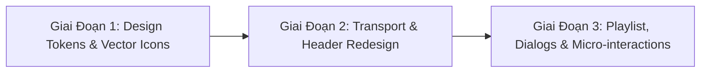

# Báo Cáo Đánh Giá & Kế Hoạch Cải Thiện Giao Diện LumiePlayer (update_ui.md)

> **Kỹ năng áp dụng:** `/ui-review` (Design Token Compliance, Visual Coherence, Studio Aesthetics & Accessibility)  
> **Phiên bản hiện tại:** LumiePlayer v1.5.1  
> **Trạng thái đánh giá:** ⚠️ **Needs Improvement (Cần cải thiện toàn diện)**  
> **Mục tiêu:** Nâng cấp LumiePlayer từ giao diện prototype tiện ích lên chuẩn giao diện phần mềm dựng phim & hậu kỳ chuyên nghiệp (Studio-Grade Pro App như DaVinci Resolve, Adobe Premiere Pro, TwinLens).

---

## 1. Tổng Quan Điểm Đánh Giá UI/UX (UI Scorecard)

| Tiêu chuẩn đánh giá | Điểm | Đánh giá | Trọng tâm cần cải thiện |
| :--- | :---: | :---: | :--- |
| **1. Visual Coherence (Nhất quán hình ảnh)** | 5.5 / 10 | ⚠️ Yếu | Lẫn lộn nhiều mã màu hex tự do, emoji hệ điều hành xen lẫn ký tự Unicode. |
| **2. Iconography (Hệ thống biểu tượng)** | 4.0 / 10 | ❌ Kém | Lạm dụng Emoji Windows (📂, 💾, ⚡, 📑, ℹ, ⛶, ⏪, ⏩, 🔇, 📥) gây mất tính chuyên nghiệp. |
| **3. Typography & Text Hierarchy** | 6.5 / 10 | ⚠️ Trung bình | Timecode rõ ràng nhưng phân cấp kích thước font chữ (10px–18px) chưa có scale chuẩn. |
| **4. Control Sizing & Alignment** | 5.0 / 10 | ⚠️ Yếu | Chiều cao nút bấm trên cùng 1 hàng nhảy lộn xộn (20px, 24px, 30px, 36px). |
| **5. Corner Radius & Shape Personality**| 6.0 / 10 | ⚠️ Trung bình | Trộn lẫn góc bo 3px, 4px, 6px, 8px, 18px (pill) và 32px không theo tỉ lệ lồng nhau. |
| **6. Accessibility & Contrast (a11y)** | 6.0 / 10 | ⚠️ Trung bình | Nhiều nhãn trạng thái xám `#52525B` có độ tương phản thấp (< 3:1), thiếu focus-visible. |
| **7. Layout Density & Organization** | 7.0 / 10 | 🟢 Khá | Bố cục tổng thể 3 hàng hợp lý nhưng hàng transport controls dưới cùng quá chật chội. |
| **8. Interactive Feedback & States** | 5.5 / 10 | ⚠️ Yếu | Nút bấm thiếu hiệu ứng khi hover/pressed rõ nét; chưa có style cho trạng thái Disabled. |
| **TỔNG THỂ** | **5.7 / 10** | ⚠️ **CẦN CẢI THIỆN TOÀN DIỆN ĐỂ ĐẠT CHUẨN STUDIO** |

---

## 2. Phân Tích Chi Tiết 8 Vấn Đề Cốt Lõi (In-Depth Review)

### Vấn Đề 1: "Hội chứng Emoji" làm giảm giá trị ứng dụng chuyên nghiệp
- **Thực trạng:** 
  - Các nút thanh công cụ và điều khiển đang dùng trực tiếp Emoji hệ điều hành: `📂 Open Video`, `⚡ Compare`, `💾 Save`, `📑 Playlist`, `ℹ Inspector`, `⛶ Fullscreen`, `⏪ -5s`, `⏩ +5s`, `🔇 Mute`, `📥 Drop Video`.
  - Trên Windows 10/11, phông Segoe UI Emoji vẽ các emoji này dạng hình vẽ hoạt hình nhiều màu sắc (vàng, xanh lá, đỏ cam), tạo cảm giác rời rạc, thiếu đồng bộ và nghiệp dư.
- **Giải pháp chuẩn Studio:**
  - Thay thế 100% emoji bằng **Hệ thống Vector Geometry Path (Lucide / Feather / Studio Icons)** hiển thị sắc nét bằng vector monochrome (`currentColor`).
  - Khi hover/active, biểu tượng tự động đổi màu mượt mà theo Accent Color của theme.

---

### Vấn Đề 2: Bảng màu rời rạc, thiếu Design Tokens tập trung
- **Thực trạng:**
  - Trong `MainWindow.xaml`, có hơn 15 mã màu nền đen/xám khác nhau được hardcode trực tiếp inline: `#0F0F12`, `#141418`, `#18181E`, `#131317`, `#0A0A0C`, `#09090B`, `#101014`, `#1C1C20`, `#27272A`, `#2E2E38`, `#3F3F4E`, `#3F3F46`.
  - Hai màu xanh nhấn cạnh tranh nhau: Xanh hoàng gia `#2563EB` (nút Play, Jump) và Xanh da trời `#38BDF8` (Timeline, Brand, Active state), khiến giao diện bị "đa nhân cách".
- **Giải pháp chuẩn Studio:**
  - Định nghĩa **Design Token Palette** duy nhất trong `App.xaml` hoặc ResourceDictionary:
    - **Nền chính (Background Layers):**
      - `AppBgBase`: `#09090B` (Vùng render video & nền gốc)
      - `AppBgElevated`: `#121215` (Thanh Toolbar trên & Thanh điều khiển dưới)
      - `AppBgSurface`: `#18181C` (Playlist, Card, Dialogs)
      - `AppBgInput`: `#1E1E24` (Ô input, track trượt, nút phụ)
    - **Đường viền (Borders):**
      - `AppBorderSubtle`: `#26262B`
      - `AppBorderStrong`: `#3A3A42`
    - **Accent Color duy nhất:**
      - `AppAccentPrimary`: `#0284C7` / `#38BDF8` (Cyan/Sky Studio Pro)
      - `AppAccentHover`: `#0EA5E9`
      - `AppAccentActive`: `#0369A1`
    - **Màu ngữ nghĩa (Semantic Status):**
      - `StatusSuccess`: `#10B981` (Xanh lá)
      - `StatusWarning`: `#F59E0B` (Vàng hổ phách - Timecode B)
      - `StatusDanger`: `#EF4444` (Đỏ - Playhead, Mute, Clear)

---

### Vấn Đề 3: Chiều cao nút bấm và căn chỉnh lộn xộn (Inconsistent Control Sizing)
- **Thực trạng trên hàng Transport Controls:**
  - Nút Play/Pause: `Height="36"`, `Width="60"` (Pill hình bầu dục 18px).
  - Nút Loop / Frame / Seek: `Padding="10,6"` (chiều cao ~30px, góc bo 4px).
  - Hộp chọn Speed ComboBox: chiều cao mặc định hệ thống ~24px.
  - Các nút chỉnh Offset B (`-0.1s`, `+0.1s`): `Padding="4,2"` (chiều cao chỉ ~20px).
  - Các nút Split Wipe trên Topbar: `Padding="4,1"`, `FontSize="10"` (chiều cao ~18px).
  - Khi đặt cạnh nhau trên một hàng ngang, các nút lồi lõm không cùng chiều cao cơ sở (Baseline).
- **Giải pháp chuẩn Studio:**
  - Chuẩn hóa hệ thống kích thước chuẩn (Standard Size Ladder):
    - **Control Height Small (24px):** Dành cho badge, nút phụ, nút offset vi mô.
    - **Control Height Medium (30px):** Chiều cao chuẩn cho toàn bộ nút bấm Toolbar, Loop, Transport, ComboBox.
    - **Control Height Large (36px):** Dành riêng cho nút Play/Pause trung tâm.
  - Sử dụng chung một `MinHeight` và `VerticalAlignment="Center"` để toàn bộ icon, text và border thẳng hàng pixel-perfect.

---

### Vấn Đề 4: Góc bo (Corner Radius) chưa đồng nhất
- **Thực trạng:**
  - Toolbar buttons: `CornerRadius="4"`.
  - Topbar Overlay: `CornerRadius="6"`.
  - Drop Border: `CornerRadius="8"`.
  - Play Button: `CornerRadius="18"` (Pill tròn vo hoàn toàn).
  - Placeholder Circle: `CornerRadius="32"`.
  - Việc trộn lẫn góc bo vuông vức 4px của thanh công cụ với nút Play tròn vo 18px vi phạm nguyên tắc *"One radius personality"* trong thiết kế ứng dụng chuyên nghiệp.
- **Giải pháp chuẩn Studio:**
  - Thống nhất **Studio Radius Scale**:
    - `RadiusNone`: `0px` (Khung player, Splitter)
    - `RadiusSm`: `4px` (Buttons, Badges, Sliders, Dropdowns)
    - `RadiusMd`: `6px` (Panels, Overlays, Cards, Dialogs)
    - `RadiusLg`: `8px` (Cửa sổ, Dialog container, Highlight borders)
  - Nút Play/Pause điều chỉnh thành hình chữ nhật bo góc `RadiusSm` hoặc `RadiusMd` tinh tế (tương tự Davinci Resolve / Premiere), loại bỏ hình viên thuốc tròn xoe kiểu mobile app.

---

### Vấn Đề 5: Bố cục thanh điều khiển Transport quá tải khi ở Compare Mode
- **Thực trạng:**
  - Hàng thứ 2 của Dock dưới chứa đồng thời:
    - Nhóm 1 (Trái): Loop A, Loop B, Clear, Tóm tắt vòng lặp.
    - Nhóm 2 (Giữa): Rewind 5s, 1s, Frame Step, Big Play/Pause, Frame Step, Forward 1s, 5s, Speed Selector.
    - Nhóm 3 (Phải): Offset B (-0.1, -0.01, +0.01, +0.1, 0), Audio Source (A, B, Mute), Toggle Mute, Volume Slider.
  - Khi bật chế độ Compare Mode, nhóm bên phải phình to chiếm hơn 380px, chèn ép nhóm Playback ở giữa khiến giao diện bị lệch tâm hoặc tràn khung khi kích thước cửa sổ thu nhỏ về `900px` (MinWidth).
- **Giải pháp chuẩn Studio:**
  - Chuyển cụm chọn Audio Source (A, B, Mute) và Chỉnh Offset B thành **Segmented Button Bar** siêu gọn gàng.
  - Đưa nhóm Loop A-B sang dạng popover hoặc thanh công cụ phụ; giữ cho cụm Playback trung tâm luôn cố định chính giữa màn hình (True Center).

---

### Vấn Đề 6: Thiếu Segmented Controls hiện đại
- **Thực trạng:**
  - Chọn Chế độ so sánh (Side by Side vs Split Wipe) đang dùng `RadioButton` mặc định của WPF với dấu tròn radio kiểu form khảo sát web cũ kỹ.
  - Tương tự, chọn Audio Source (`RbAudioA`, `RbAudioB`, `RbAudioMute`) cũng là các RadioButton dạng chấm tròn.
- **Giải pháp chuẩn Studio:**
  - Xây dựng **Segmented Toggle Group**: Khối thanh trượt bọc nền tối (`#1E1E24`), bên trong là các tab chuyển trạng thái dạng viên gạch trượt, có hiệu ứng highlight màu xanh sắc sảo khi chọn.

---

### Vấn Đề 7: Bảng Danh Sách Phát (Playlist) Đơn Điệu
- **Thực trạng:**
  - Danh sách video trong Playlist hiện chỉ là một ListBox đơn giản, hiển thị 2 dòng text mỏng.
  - Thiếu thumbnail video, thiếu số thứ tự `01`, `02`, thiếu chỉ báo video nào đang được phát (Playing Indicator: biểu tượng loa hoặc sóng âm nhỏ).
  - Khi hover vào item trong playlist, hiệu ứng hover rất mờ nhạt.
- **Giải pháp chuẩn Studio:**
  - Bổ sung chỉ báo trạng thái: `[PLAYING]` / Icon loa nhỏ màu xanh sáng bên cạnh video đang phát.
  - Thêm số thứ tự chỉ mục `Track Index` bên trái, căn chỉnh thông số kỹ thuật (Resolution, FPS, Codec) thành các chip nhỏ gọn.

---

### Vấn Đề 8: Trạng Thái Tương Tác (Feedback & Micro-interactions)
- **Thực trạng:**
  - Nút bấm khi di chuột vào (`IsMouseOver`) chỉ đổi màu nền nhẹ (`#27272A`), không có chuyển tiếp độ mờ (fade transition), không có đường viền viền sáng (border glow).
  - Nút bấm khi ấn xuống (`IsPressed`) không có phản hồi thị giác (click scale hoặc màu tối hơn).
  - Chưa khai báo style cho `IsEnabled="False"`: Khi một nút bị vô hiệu hóa, người dùng không phân biệt được.
- **Giải pháp chuẩn Studio:**
  - Bổ sung đầy đủ 4 trạng thái tương tác cho mọi Button/Toggle: `Normal` → `Hover` (viền sáng nhẹ + nền sáng hơn) → `Pressed` (lún nhẹ 1px hoặc nền đậm) → `Disabled` (Opacity 0.4, cursor NotAllowed).

---

## 3. Danh Sách Vấn Đề Chi Tiết Theo Từng File (Code Violations)

### File: `MainWindow.xaml`
- `L65-L87` (`Style ToolbarBtn`): Padding 10,6 nhưng không quy định `Height`, font size 13px; hover chỉ đổi nền không có hiệu ứng viền.
- `L89-L113` (`Style ControlBtn`): Thiếu trigger `IsEnabled="False"`, nút disabled không mờ đi.
- `L144-L145` & `L205-L206`: Dùng Emoji `📂`, `💾`.
- `L158`: Text `⚡ Compare: ` dùng emoji tia sét.
- `L181-L187`: RadioButton "Side by Side" và "Split Wipe" dùng kiểu chấm tròn mặc định, gây vỡ phong cách Studio.
- `L194-L202`: Nút `100% A`, `50% Split`, `100% B`, `Flip [Tab]` có padding `4,1` quá nhỏ, khó click chuột (vi phạm Fitts's Law).
- `L211-L225`: ToggleButton Waveform, Playlist, Fullscreen dùng emoji `〰`, `📑`, `ℹ`, `⛶`.
- `L416-L447`: Transport Controls dùng emoji `⏪`, `◀`, `⏮`, `⏭`, `▶`, `⏩`.
- `L421-L443`: Nút Play hình viên thuốc tròn `CornerRadius="18"` lệch phong cách góc bo 4px của toàn bộ app.
- `L487-L491`: RadioButton Audio A, B, Mute dùng chấm tròn radio.
- `L515-L517`: Thanh Shortcuts dùng màu `#52525B` trên nền `#0C0C0E` độ tương phản thấp (2.7:1), vi phạm chuẩn WCAG AA.

### File: `VideoPlayerControl.xaml`
- `L21-L23`: Placeholder vòng tròn `Width="64" Height="64" CornerRadius="32"` lệch tâm và thiếu đường viền hiện đại.
- `L41-L58`: Header badge `RoleBadge` màu `#2563EB` (Royal Blue) lệch với Accent Color chung `#38BDF8` (Sky Blue).
- `L74-L80`: Khung thả video `DropHighlightBorder` dùng màu xanh đặc `#661E3A8A` và emoji `📥 Drop Video Here`.

### File: `WaveformControl.xaml`
- `L24-L27`: Hover pill `HoverPill` có viền `#38BDF8` nhưng nền `#DD18181B` không có đổ bóng nhẹ tách lớp với sóng âm bên dưới.
- `L34-L35`: Text thông báo không có audio màu `#52525B` quá tối, khó đọc trên màn hình độ sáng thấp.

### File: `MetadataDialog.xaml` & `TimecodeJumpDialog.xaml`
- Khung viền và nút bấm của các hộp thoại này sử dụng màu xám sáng `#27272A` / `#3F3F46` chưa đồng bộ với các token của cửa sổ chính.
- Nút Jump và Cancel trong Jump Dialog có kích thước chưa cân xứng.

---

## 4. Kế Hoạch Triển Khai Cải Thiện Giao Diện (Roadmap 3 Giai Đoạn)



### 🎯 Giai Đoạn 1: Thiết Lập Hệ Thống Design Tokens & Vector Iconography
1. **Tạo từ điển tài nguyên màu sắc tập trung (`Styles/DarkThemeTokens.xaml` hoặc trong `Window.Resources`):**
   - Chuẩn hóa hệ màu Studio Dark (`#0B0B0E`, `#131317`, `#1A1A20`, `#22222A`).
   - Chuẩn hóa Accent Color: `#0284C7` (chính) / `#38BDF8` (sáng) / `#0369A1` (nhấn).
2. **Xây dựng Thư Viện Vector Icons (Geometry Paths):**
   - Biểu tượng Play, Pause, Frame Forward, Frame Backward, Seek Forward, Seek Backward.
   - Biểu tượng Open File, Save, Compare Split, Waveform, Playlist, Inspector, Fullscreen, Mute/Unmute, Loop.
   - Xóa bỏ 100% các ký tự Emoji khỏi toàn bộ mã nguồn XAML.

### 🎯 Giai Đoạn 2: Tái Cấu Trúc Toàn Diện Header & Transport Controls
1. **Thiết kế lại Top Toolbar:**
   - Tạo khối thương hiệu LumiePlayer sang trọng với icon studio và badge phiên bản.
   - Chuyển cụm so sánh thành **Segmented Switch Control**: `[ Side by Side | Split Wipe ]`.
   - Chuẩn hóa thanh công cụ bên phải (Waveform, Playlist, Metadata Inspector, Fullscreen) đồng đều chiều cao 30px.
2. **Thiết kế lại Bottom Transport Bar:**
   - **Cụm Playback Trung Tâm:**
     - Nút Play/Pause vuông bo góc tinh tế (`Width="48" Height="32" CornerRadius="6"`), tích hợp vector Play/Pause sắc sảo.
     - Các nút Frame Step và Seek được xếp thành cụm button group liền mạch (Connected Button Group).
     - ComboBox tốc độ phát được style lại tiệp màu với thanh công cụ.
   - **Cụm Bên Phải (Compare & Audio):**
     - Chuyển `Audio: [A] [B] [Mute]` thành Segmented Button Bar nhỏ gọn.
     - Chuyển cụm Offset B thành Stepper widget chuyên nghiệp: có nhãn `OFFSET` nhỏ gọn và nút `+` / `-` tinh gọn.
   - **Cụm Bên Trái (Loop A-B):**
     - Gom nút Loop A, Loop B, Clear thành nhóm nút liên hoàn có icon điểm đầu `[`, điểm cuối `]` sắc nét.

### 🎯 Giai Đoạn 3: Nâng Cấp Playlist, Video Overlay, Dialogs & Animation
1. **Nâng cấp Playlist:**
   - Thêm số thứ tự bài phát `#01`, `#02`.
   - Thêm chỉ báo sóng âm mini cho video đang phát `[Playing Indicator]`.
   - Thiết kế lại các badge Resolution, FPS, Duration thành các tag viền xám chuyên nghiệp.
2. **Nâng cấp Video Overlay & Drop Target:**
   - Thay thế overlay góc trên và góc dưới của Player bằng thiết kế kính mờ (Frosted Acrylic Effect với viền subtle 1px).
   - Thiết kế lại Drop Target: Bỏ emoji `📥`, dùng icon vector Cloud/Film Reel với animation viền nét đứt sang trọng.
3. **Chuẩn hóa Hộp Thoại (Metadata Inspector & Jump Dialog):**
   - Đồng bộ style tab, scrollbar, textbox và button sang hệ thống token mới.
   - Thêm phím tắt Escape để đóng nhanh và Enter để xác nhận.

---

## 5. Mẫu Thiết Kế Các Thành Phần Chuẩn Hóa (Specifications)

### 5.1. Bảng Thông Số Chiều Cao Chuẩn (Size Tokens)
- `ToolbarHeight`: `42px`
- `TransportRowHeight`: `40px`
- `ButtonHeightSm`: `24px` (Offset, Wipe quick buttons)
- `ButtonHeightMd`: `30px` (Toolbar, Transport seek buttons, Segmented buttons)
- `ButtonHeightLg`: `34px` (Play/Pause button, Primary Action buttons)
- `SliderTrackHeight`: `6px`

### 5.2. Mẫu Segmented Button Group (Thay thế RadioButton)
```xml
<!-- Mẫu Segmented Switch chuẩn Studio -->
<Border Background="#121216" BorderBrush="#26262B" BorderThickness="1" CornerRadius="4" Padding="2">
    <StackPanel Orientation="Horizontal">
        <RadioButton Style="{StaticResource SegmentedRadioBtn}" Content="Side by Side" IsChecked="..."/>
        <RadioButton Style="{StaticResource SegmentedRadioBtn}" Content="Split Wipe" IsChecked="..."/>
    </StackPanel>
</Border>
```

### 5.3. Thư Viện Vector Icons Đề Xuất (System Geometries)
- **Play:** `M8 5v14l11-7z`
- **Pause:** `M6 19h4V5H6v14zm8-14v14h4V5h-4z`
- **Step Forward:** `M4 5v14l10-7-10-7z M16 5h2v14h-2z`
- **Step Backward:** `M6 5h2v14H6z M18 5L8 12l10 7V5z`
- **Waveform:** `M3 9v6h2V9H3zm4-4v14h2V5H7zm4-2v18h2V3h-2zm4 4v14h2V7h-2zm4 4v6h2v-6h-2z`
- **Folder/Open:** `M10 4H4c-1.1 0-2 .9-2 2v12c0 1.1.9 2 2 2h16c1.1 0 2-.9 2-2V8c0-1.1-.9-2-2-2h-8l-2-2z`
- **Compare:** `M4 4h7v16H4zm9 0h7v16h-7z`

---

## 6. Kết Luận & Đề Xuất Hành Động Tiếp Theo
Kế hoạch trên khắc phục triệt để các hạn chế hiện tại về mặt thẩm mỹ, tính chuyên nghiệp và khả năng tương tác của LumiePlayer mà không làm thay đổi hay ảnh hưởng đến logic phát video và đồng bộ Direct3D/MPV bên dưới.

**Các bước hành động đề xuất:**
1. Người dùng xem xét và phê duyệt kế hoạch trong file `update_ui.md`.
2. Triển khai tuần tự theo 3 giai đoạn:
   - **Giai đoạn 1:** Xây dựng Design Tokens + Vector Icons trong `MainWindow.xaml`.
   - **Giai đoạn 2:** Nâng cấp Topbar & Transport Bar sang phong cách Studio Pro.
   - **Giai đoạn 3:** Hoàn thiện Playlist, Video Overlay và Hộp thoại Inspector.
