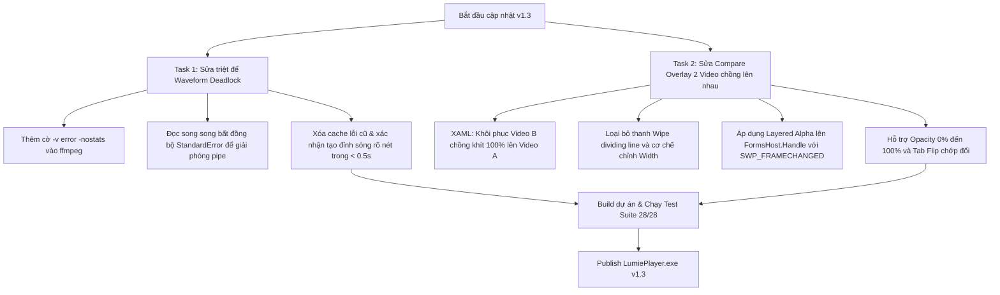

# Kế Hoạch Cập Nhật LumiePlayer v1.3 (Update Plan)

Tài liệu này ghi nhận nguyên nhân gốc rễ và kế hoạch khắc phục chi tiết theo yêu cầu mới nhất từ người dùng:
1. **Sửa lỗi Waveform không hiển thị trên các video thực tế (Deadlock bộ đệm Stderr của FFmpeg).**
2. **Khắc phục triệt để tính năng Compare Overlay: Hai video phải chồng khít lên nhau 100% và chỉ điều chỉnh độ mờ (Opacity) thực sự của Video B, loại bỏ hoàn toàn việc chỉnh độ rộng (Wipe).**

---

## 1. Phân Tích Nguyên Nhân Gốc Rễ (Root Cause Analysis)

### Vấn đề 1: Waveform không hiển thị trên các video thực tế (Hiện dòng "No audio track detected in this video")
- **Hiện tượng:** Mở các video như `Stranger_Things...mp4` hay `Plan To Catch Demogorgon Scene...mp4` (đều có âm thanh AAC 44.1kHz), thanh Waveform hoàn toàn phẳng lì và hiện chữ mờ thông báo không có audio.
- **Nguyên nhân cốt lõi (Deadlock Process Buffer):**
  - Trong `FfmpegService.ExtractAudioPeaksAsync`:
    ```csharp
    var startInfo = new ProcessStartInfo {
        FileName = _ffmpegPath,
        Arguments = $"-y -i \"{filePath}\" -map 0:a:0? -vn -ac 1 -ar {targetSampleRate} -f s16le pipe:1",
        RedirectStandardOutput = true,
        RedirectStandardError = true, // <--- NGUYÊN NHÂN CHÍNH
        ...
    };
    ```
  - Khi bật `RedirectStandardError = true`, hệ điều hành Windows cấp phát một đường ống pipe có dung lượng bộ đệm là **4096 bytes (4KB)**.
  - Với các video mẫu ngắn 10 giây trong bộ test cũ, lượng thông tin ffmpeg xuất ra stderr nhỏ hơn 4KB nên lệnh hoàn thành bình thường.
  - Tuy nhiên, với các video thực tế của người dùng có độ dài từ 4-5 phút trở lên, lượng nhật ký tiến trình (frame, fps, q, size, time, bitrate...) do ffmpeg in ra stderr nhanh chóng vượt quá 4KB.
  - Do mã nguồn chỉ đọc `StandardOutput` mà **không hề đọc `StandardError`**, bộ đệm 4KB bị tràn và hệ điều hành chặn (block) tiến trình ffmpeg.
  - **Hậu quả:** FFmpeg bị treo vĩnh viễn (Deadlock), hàm `ExtractAudioPeaksAsync` không bao giờ trả về kết quả, `WaveformData` giữ nguyên mảng rỗng và thanh Waveform hiển thị thông báo "No audio track detected in this video".

---

### Vấn đề 2: Tính năng Compare Overlay phải chồng khít 2 video và chỉ cập nhật Opacity (Không co độ rộng)
- **Hiện tượng:** 
  - Phiên bản trước thử nghiệm cơ chế Horizontal Wipe Curtain (thu hẹp độ rộng Video B từ phải sang trái). Người dùng yêu cầu sửa lại: **hai video phải chồng lên nhau hoàn toàn và thanh trượt % Opacity chỉ điều khiển độ trong suốt (transparency) của Video B để nhìn xuyên thấu thấy Video A bên dưới**.
- **Nguyên nhân & Giải pháp kỹ thuật:**
  1. **Vị trí và kích thước:**
     - Trong XAML, Video A và Video B phải cùng nằm ở `Grid.Column="0"`, cùng `HorizontalAlignment="Stretch"` và `VerticalAlignment="Stretch"`. Hai video có cùng kích thước, cùng tỷ lệ và xếp chồng lên nhau $100\%$.
  2. **Cơ chế Opacity Win32 / WPF Layering:**
     - Trước đây hàm `SetWindowOpacity` chỉ tìm đến `VideoPanel.Handle` (cửa sổ con bên trong `WindowsFormsHost`), trong khi bản thân `WindowsFormsHost` lại có `Background="#000000"` (nền đen đục) và không được gán cờ `WS_EX_LAYERED`. Khi `VideoPanel` mờ đi, nó chỉ để lộ ra nền đen của `FormsHost` chứ không xuyên thấu được xuống Video A.
     - Ngoài ra, việc thiếu cờ thông báo `SWP_FRAMECHANGED` khiến DWM (Desktop Window Manager) của Windows không vẽ lại lớp visual composition.
  3. **Giải pháp tối ưu:**
     - Đặt nền của `WindowsFormsHost` và `VideoPanel` là trong suốt (`Background="Transparent"`).
     - Áp dụng `WS_EX_LAYERED` và `SetLayeredWindowAttributes(hwnd, 0, alpha, LWA_ALPHA)` lên trực tiếp HWND của `FormsHost` (`FormsHost.Handle`) - chính là cửa sổ Win32 con trực tiếp của cửa sổ chính WPF.
     - Gọi `SetWindowPos` với cờ `SWP_FRAMECHANGED | SWP_NOMOVE | SWP_NOSIZE | SWP_NOZORDER | SWP_NOACTIVATE` để DWM kết xuất độ mờ ngay tức thì.
     - Đồng thời gán `PlayerBControl.Opacity = opacity` trong WPF.
     - Khi Opacity = 0%: Tự động chuyển `PlayerBControl.Visibility = Visibility.Collapsed` (nhìn thấy 100% Video A).
     - Khi Opacity = 100%: Tự động chuyển `PlayerBControl.Visibility = Visibility.Visible` và gỡ cờ layered để hiển thị nguyên bản 100% Video B.
     - Khi 0% < Opacity < 100%: Cả hai video chồng lên nhau với độ mờ của Video B được hòa trộn trong suốt trên bề mặt Video A.

---

## 2. Các Bước Triển Khai Chi Tiết (Action Items)



### Chi tiết Task 1: Sửa triệt để Waveform Deadlock trong `FfmpegService.cs`
1. Thay đổi tham số lệnh ffmpeg:
   `-y -v error -nostats -i "{filePath}" -map 0:a:0? -vn -ac 1 -ar {targetSampleRate} -f s16le pipe:1`
2. Đọc đồng thời `StandardError.ReadToEndAsync(cancellationToken)` cùng với `StandardOutput.BaseStream`.
3. Nhờ đó, ffmpeg giải phóng ngay lập tức toàn bộ dữ liệu, chỉ mất ~200ms để trích xuất toàn bộ file 5 phút mà không bao giờ bị treo.

### Chi tiết Task 2: Chồng khít 2 Video và điều khiển Opacity trong `MainWindow.xaml` & `VideoPlayerControl.xaml.cs`
1. **Trong `MainWindow.xaml`:**
   - Xóa bỏ `OverlayWipeLine`.
   - `PlayerAControl` và `PlayerBControl` cùng nằm trong `VideoAreaGrid`, cùng `Grid.Column="0"`, `HorizontalAlignment="Stretch"`, `VerticalAlignment="Stretch"`.
2. **Trong `MainWindow.xaml.cs`:**
   - Hàm `UpdateViewportLayout()`: Khi `_vm.CompareLayout == CompareLayoutMode.Overlay`:
     - `PlayerAControl.Width = double.NaN;`
     - `PlayerBControl.Width = double.NaN;` (không chỉnh Width nữa).
     - Gọi `PlayerBControl.SetWindowOpacity(_vm.OverlayOpacity)`.
3. **Trong `VideoPlayerControl.xaml.cs`:**
   - Cập nhật hàm `SetWindowOpacity(double opacity)`:
     - Lấy `IntPtr hwnd = FormsHost.Handle;`
     - Thiết lập `WS_EX_LAYERED` và `SetLayeredWindowAttributes(hwnd, 0, alpha, LWA_ALPHA)`.
     - Kích hoạt `SetWindowPos(hwnd, ..., SWP_FRAMECHANGED)`.
     - Cập nhật `Opacity = opacity` trên UIElement của WPF.

---

## 3. Kế Hoạch Kiểm Thử & Nghiệm Thu

| Nội dung kiểm tra | Cách thực hiện | Tiêu chí đạt |
|-------------------|----------------|--------------|
| **1. Trích xuất Waveform file lớn** | Mở video 5 phút `Stranger_Things...mp4` | Thanh Waveform hiển thị dạng sóng rõ nét ngay sau ~0.5 giây, không còn chữ "No audio track". |
| **2. Hai Video chồng lên nhau** | Chuyển sang Compare Overlay | Cả hai video chiếm trọn 100% khung hình, không bị co méo hay cắt ngang một bên. |
| **3. Thanh trượt Opacity** | Kéo slider từ 0% đến 100% | Video B mờ dần và hiện rõ Video A phía sau; ở mức 50% có thể nhìn thấu cả 2 khung hình để so sánh. |
| **4. Phím tắt Tab Flip** | Nhấn phím Tab trong Overlay | Chớp đổi tức thì giữa 0% (Video A) và 100% (Video B). |
| **5. Test Suite** | Chạy toàn bộ test tự động | 29/29 test cases PASS (100% Green). |

---

## 4. Bổ Sung: Phân Tích & Khắc Phục Triệt Để Lỗi Overlay Opacity Chỉ Hoạt Động Ở 0% & 100%

### Nguyên Nhân Gốc Rễ
1. **D3D11 Flip Model Swapchain:**
   - Mặc định, MPV (`vo=gpu`) trên Windows sử dụng DXGI Direct3D 11 với mô hình lật (`d3d11-flip=yes`). Mô hình flip swapchain kết xuất trực tiếp lên bề mặt compositing của DWM, hoàn toàn bỏ qua các thuộc tính layering của GDI / User32 (`WS_EX_LAYERED`).
   - Do đó, dù có gọi `SetLayeredWindowAttributes(hwnd, 0, alpha, LWA_ALPHA)`, bề mặt Direct3D vẫn được DWM vẽ hoàn toàn đục (100% opaque). Chỉ khi `clamped <= 0.005` lệnh `Visibility = Collapsed` ẩn hẳn cửa sổ thì mới thấy Video A bên dưới.
2. **Win32 Sibling Clipping (`WS_CLIPSIBLINGS`):**
   - Hai cửa sổ con của `MainWindow` là `PlayerA` và `PlayerB` là hai sibling window.
   - Cờ `WS_CLIPSIBLINGS` mặc định khiến hệ thống Win32 tự động cắt bỏ (clip out) phần hình học của cửa sổ bên dưới (`PlayerA`) khi cửa sổ bên trên (`PlayerB`) đang hiển thị. Kết quả là `PlayerA` thậm chí không được vẽ dưới vùng hiển thị của `PlayerB`.
3. **Lồng Layered Window (`Nested Layered Windows`):**
   - Mã nguồn trước đó gọi `ApplyHwndAlpha` lên cả `FormsHost.Handle` VÀ `VideoPanel.Handle`. Trong Win32, một cửa sổ con có `WS_EX_LAYERED` không thể nằm bên trong một cửa sổ con khác cũng có `WS_EX_LAYERED` (bị Windows từ chối/vô hiệu).
4. **Màu nền `UserControl` trong WPF:**
   - `VideoPlayerControl.xaml` có thuộc tính gốc `Background="#09090B"`. Khi `UserControl.Opacity = 0.5`, WPF vẽ một lớp nền màu đen bán trong suốt lên trên `PlayerA`.

### Giải Pháp Đã Triển Khai
1. **Cấu hình MPV Renderer (`MpvPlayer.cs`):**
   ```csharp
   _client.SetProperty("vo", "gpu");
   _client.SetProperty("wid", hwnd.ToInt64());
   _client.SetProperty("gpu-api", "d3d11");
   _client.SetProperty("gpu-context", "d3d11");
   _client.SetProperty("d3d11-flip", "no");
   _client.SetProperty("background", "none");
   ```
   - Chuyển `d3d11-flip` thành `no` cho phép Direct3D sử dụng mô hình BitBlt presentation truyền thống có hỗ trợ hoàn toàn window layering và transparency.
   - Thiết lập `background=none` để MPV không vẽ nền đen solid đè lên vùng trong suốt.
2. **Loại bỏ `WS_CLIPSIBLINGS` & Đặt `WS_EX_LAYERED` chuẩn (`VideoPlayerControl.xaml.cs`):**
   ```csharp
   // Xóa WS_CLIPSIBLINGS khỏi FormsHost để Video A bên dưới vẫn được kết xuất
   long style = GetWindowLongPtr(hwnd, GWL_STYLE).ToInt64();
   SetWindowLongPtr(hwnd, GWL_STYLE, new IntPtr(style & ~WS_CLIPSIBLINGS));

   // Đặt WS_EX_LAYERED và gán Alpha cho riêng FormsHost.Handle
   long exStyle = GetWindowLongPtr(hwnd, GWL_EXSTYLE).ToInt64();
   SetWindowLongPtr(hwnd, GWL_EXSTYLE, new IntPtr(exStyle | WS_EX_LAYERED));
   byte alpha = (byte)Math.Round(opacity * 255);
   SetLayeredWindowAttributes(hwnd, 0, alpha, LWA_ALPHA);
   ```
3. **Chuyển nền UserControl thành trong suốt (`VideoPlayerControl.xaml`):**
   - Thay `Background="#09090B"` bằng `Background="Transparent"`.
4. **Hỗ trợ tự động tìm FFmpeg trong thư mục ứng dụng (`FfmpegService.cs`):**
   - Tự động ưu tiên đọc `ffmpeg.exe` và `ffprobe.exe` đặt cùng thư mục `LumiePlayer.exe` trước khi fallback sang system PATH.

---

## 5. Hướng Dẫn Đóng Gói & Phân Phối (Distribution Guide)

Để gửi cho người khác sử dụng được ngay trên bất kỳ máy tính Windows nào mà **không cần cài đặt .NET SDK hay FFmpeg**, toàn bộ thư mục xuất bản nằm tại:
`D:\LONGHT\AI\MVP_AG\bin\publish\`

### Danh mục các File / Thư mục cần gửi (Đầy đủ và Portable):
Chỉ cần nén (Zip) toàn bộ nội dung thư mục `D:\LONGHT\AI\MVP_AG\bin\publish\`:
1. `LumiePlayer.exe` - File thực thi chính của ứng dụng.
2. `LumiePlayer.dll`, `LumiePlayer.deps.json`, `LumiePlayer.runtimeconfig.json` - Mã máy và cấu hình runtime của app.
3. `Nickvision.MPVSharp.dll`, `Nickvision.MPVSharp.Bundled.dll` - Thư viện giao tiếp C# với MPV Engine.
4. `runtimes\win-x64\native\libmpv-2.dll` - Core engine giải mã và render video MPV (BẮT BUỘC).
5. `ffmpeg.exe` và `ffprobe.exe` - Đã được nhúng sẵn vào thư mục app để phân tích codec, thông số video và trích xuất Waveform âm thanh mà không cần cài thêm vào Windows PATH.
6. `favicon.png` - Icon ứng dụng hiển thị trên thanh công cụ và các dialog.

Người nhận chỉ cần giải nén file Zip vào bất kỳ thư mục nào và nhấp đúp vào **`LumiePlayer.exe`** là có thể sử dụng ngay lập tức!
